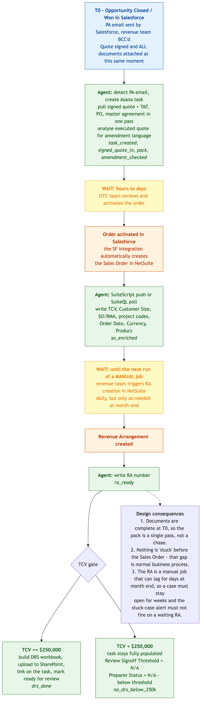
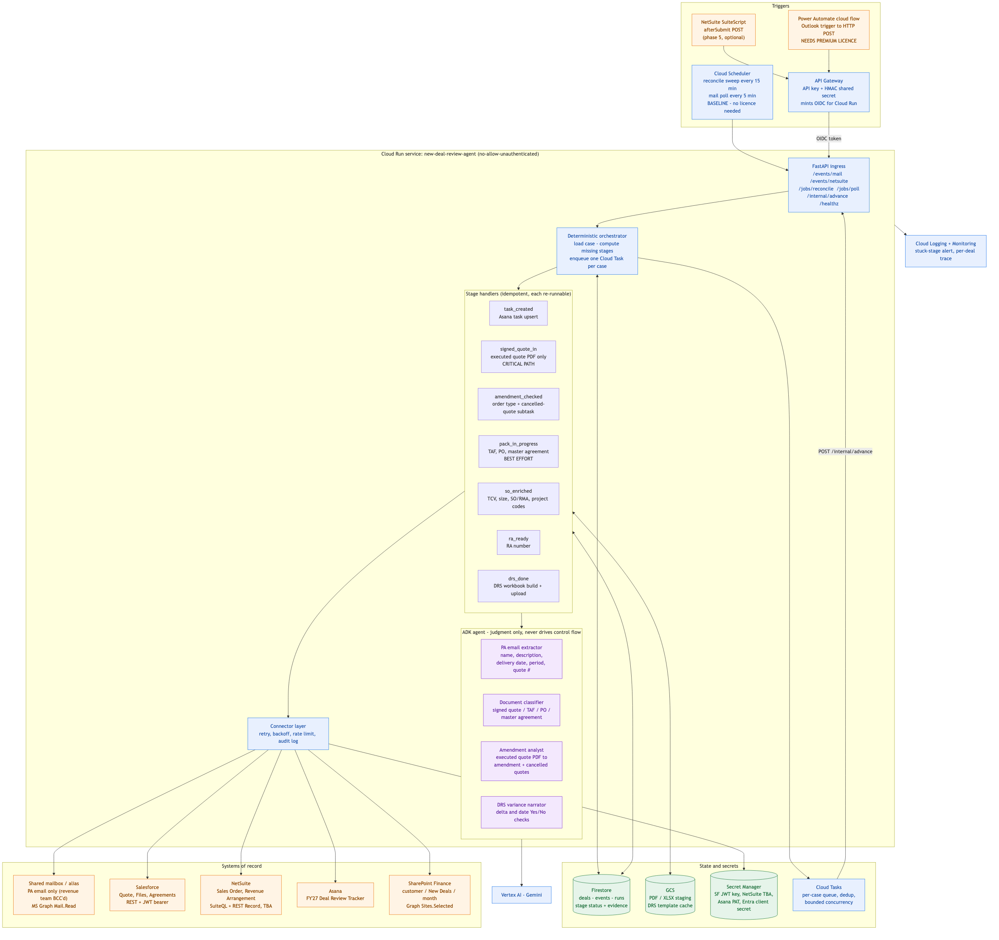
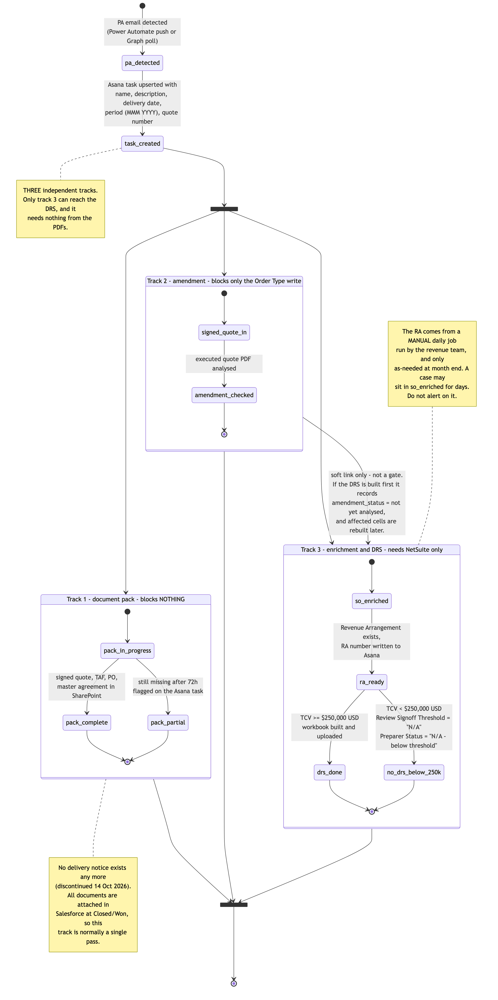
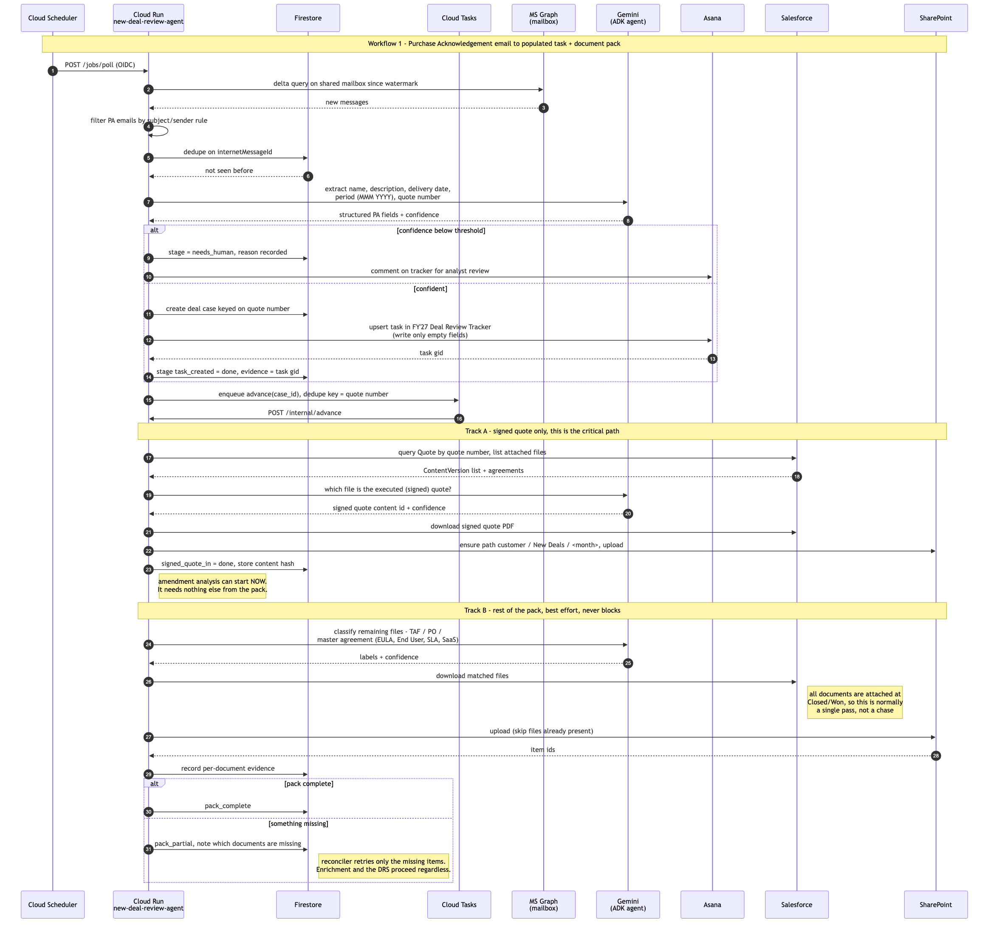
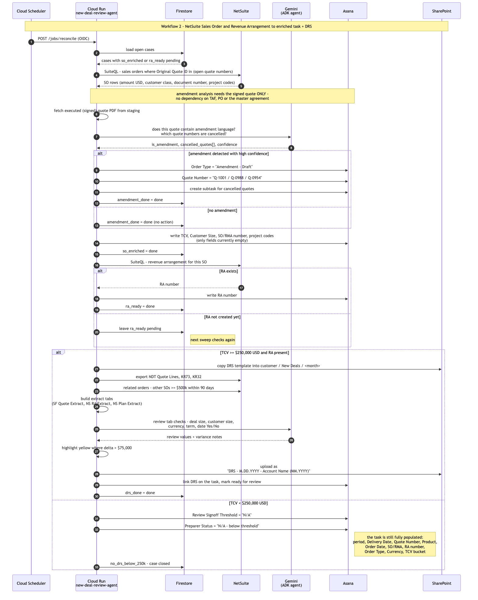
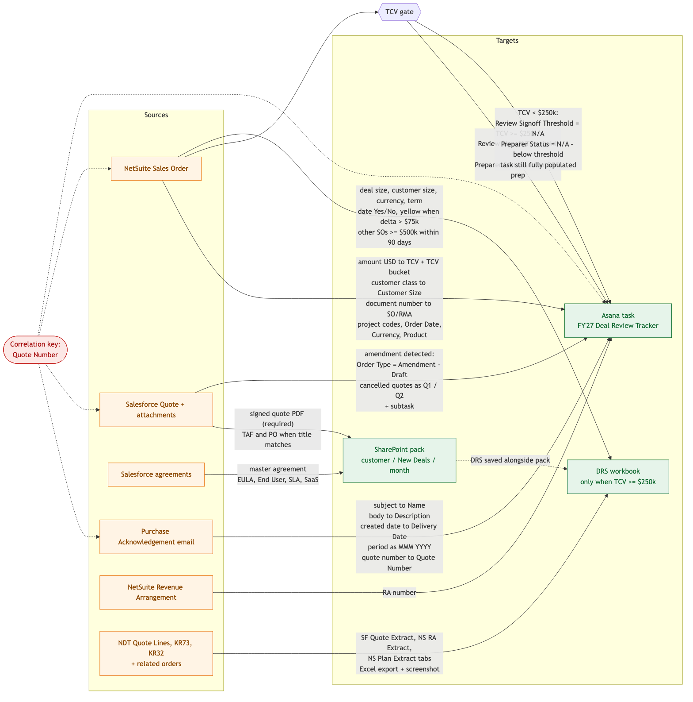
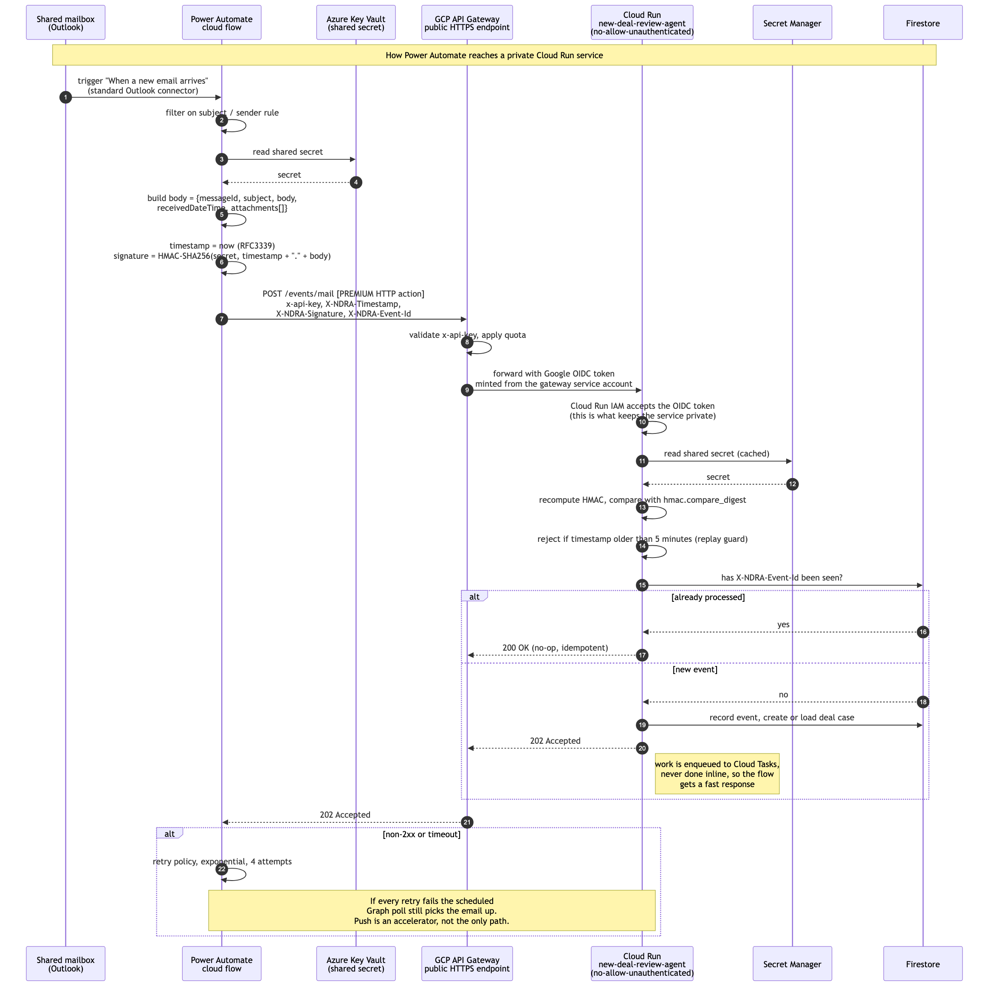
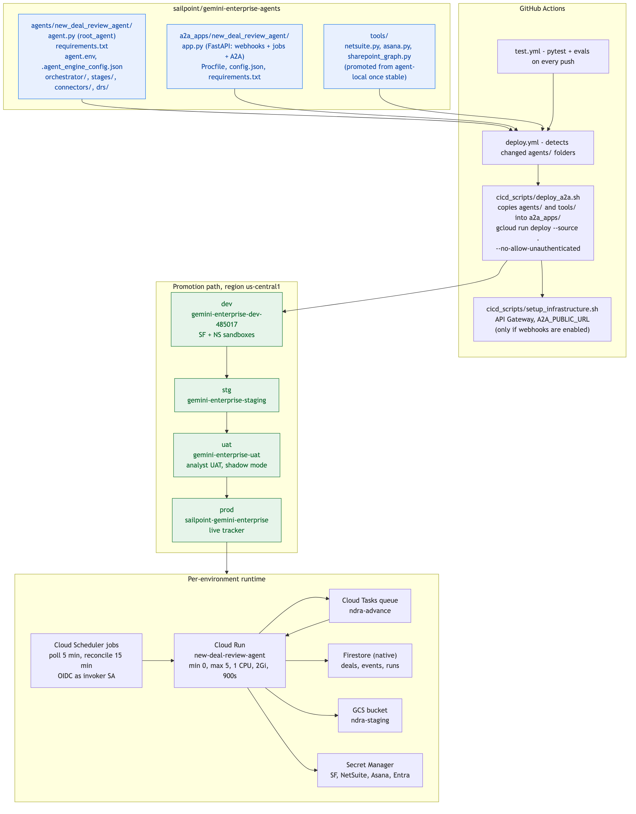

# New Deal Review Agent — Design and Delivery Plan

**Jira:** [ITAI-1270 — New Deal Review](https://sailpoint.atlassian.net/browse/ITAI-1270) (source: [ITFINSYS-673](https://sailpoint.atlassian.net/browse/ITFINSYS-673))
**Repo:** `sailpoint/gemini-enterprise-agents`
**Proposed runtime:** Cloud Run service `new-deal-review-agent`, region `us-central1`
**Status:** draft for review

---

## 1. Summary

A Revenue Analyst today assembles every new deal by hand across email, Asana, Salesforce, NetSuite, and SharePoint. This agent automates that intake end to end.

Two business workflows:

1. **Purchase Acknowledgement email arrives** — create and populate a task in the Deal Review Tracker in Asana, then collect the document pack (signed quote, TAF, PO, master agreement) into SharePoint under `customer / New Deals / <month>`.
2. **NetSuite sales order is created** — match it to the task by quote number, enrich TCV, customer size, SO/RMA and project codes, analyse the executed: quote for amendment language, and once the Revenue Arrangement exists and TCV is at least $250,000 USD, build and upload the Deal Review Sheet workbook.

The decisive design point is that **this is not a conversational agent**. Nobody prompts it. It is triggered by events, it does work, and it wakes on a schedule to finish whatever is still outstanding. That shape is what drives the runtime recommendation below.

### Constraints from the source ticket
i
[ITFINSYS-673](https://sailpoint.atlassian.net/browse/ITFINSYS-673) (parent: ITFINSYS-557 "Revenue - Contract AI", reporter Amanda Fausnacht, currently On Hold) adds three facts the deck does not cover. All three change the build.

1. **The Asana project is annual, not quarterly, and is being renamed.** Per the 11 Sep 2026 meeting notes, each Deal Review Tracker project covers Q2 Y1 to Q1 Y2 — for example 1 May 2026 to 20 Apr 2027 — to line up with the annual review thresholds that happen in Q1. The apostrophe is being removed from the name and a new convention chosen so it rolls forward cleanly each year. **The agent must therefore never hardcode "FY'27 Deal Review Tracker".** It resolves the project at runtime from a configurable name pattern plus the deal's date, and fails loudly to `needs_human` if no project matches, rather than silently writing into last year's tracker.
2. **SharePoint is getting a new parent folder.** The Finance team will create a new parent to house the historical 2024 Invoices folder and its subfolders, and that new parent is where the integration creates a folder per customer, keyed on a unique identifier. So the customer folder is matched on **the unique identifier, not the display name** — which also resolves the duplicate-company-name worry from the deck.
3. **The integration user is still unresolved.** The 19 Oct 2026 comment records that further internal discussion is needed to configure a new integration record and user. This confirms the dependency flagged in the risks table and is the single most likely cause of a Phase 0 slip.

The ticket has been on hold since Jun 2026 pending Data Engineering input, so the Phase 0 access work is as much about unblocking that as it is about credentials.

---

## 1b. Confirmed process timeline



Amanda Fausnacht has now answered the deck's open questions. Her answers change the design in five material ways.

### There is no delivery notice any more

**As of 14 Oct 2026 no delivery notice emails are sent for any deals.** It is gone from the document pack, the data map, the state model, the reconciler and the SharePoint upload. Everything the earlier draft said about chasing a late or missing delivery notice is obsolete and has been deleted rather than marked optional.

### The documents are all there at the moment the PA email fires

The PA email is sent by Salesforce when the opportunity is closed. The quote is signed and finalised at that same moment, and **every document the agent needs is attached to the relevant Salesforce objects at Closed/Won**.

That makes the document pack a single pass rather than a chase. The two-track model in section 4 still stands, because the amendment check genuinely only needs the signed quote and there is no reason to couple it to anything else, but in practice both tracks will complete on the first run. The retry machinery becomes a safety net rather than the normal path, which is a meaningfully simpler system to operate.

### The revenue team is BCC'd, so mailbox filtering cannot use To or CC

The PA email reaches the revenue team by BCC. Their address does not appear in the message headers. **The agent must therefore identify PA emails by sender plus subject pattern, never by recipient**, and the same is true of any Power Automate flow trigger condition. The sample attached to the ticket is titled "Fidelity Investments - Purchase Acknowledgement for SailPoint Offerings", which suggests a stable `<Account> - Purchase Acknowledgement for SailPoint Offerings` subject shape worth confirming across more samples.

### The Revenue Arrangement is a manual daily job, and this drives the alerting design

The sequence after the quote is signed is: the OTC team reviews and activates the order, which takes **hours to days**; order activation in Salesforce automatically creates the Sales Order in NetSuite; then the revenue team **manually triggers a NetSuite job** to create Revenue Arrangements, typically daily but only as-needed at month end.

So a case sitting in `so_enriched` waiting for an RA is normal and can legitimately last for days. The earlier draft's "alert if any case is non-terminal for more than 24 hours" would have paged on healthy deals every single month end. Alert thresholds are now per stage, and the `so_enriched → ra_ready` wait is explicitly exempt from the generic stuck-case alert. See section 11.

### Below $250k is an action, not a stop

The earlier draft treated `no_drs_below_250k` as "stop, do nothing". It is not. The Asana task is still fully populated — period, Delivery Date, Quote Number, Product, Order Date, Sales Order/RMA Number, Revenue Arrangement Number, Order Type, Currency and TCV bucket — and then two fields are set explicitly:

| Field | Value |
|---|---|
| Review Signoff Threshold | `N/A` |
| Preparer Status | `N/A - below threshold` |

Note that this answer also introduces Asana fields the deck never mentioned: **Product, Order Date, Currency, TCV bucket, Review Signoff Threshold and Preparer Status**. The field list in section 6 has been extended, and "TCV bucket" in particular needs confirming — it reads like a picklist derived from the raw amount rather than the amount itself.

### Two smaller answers

A fully executed quote PDF **cannot** be modified or overwritten in Salesforce once uploaded. That removes the content-hash-and-reanalyse machinery the earlier draft proposed: the amendment analysis runs once and the result is final.

A SuiteScript to trigger the agent on sales order creation **is possible**, which upgrades the NetSuite push from speculative to planned. See section 7.

### Reference material now on the ticket

Three attachments on [ITFINSYS-673](https://sailpoint.atlassian.net/browse/ITFINSYS-673) are the starting point for Phase 0 and should be pulled into the repo as test fixtures:

| File | Use |
|---|---|
| `Fidelity Investments - Purchase Acknowledgement for SailPoint Offerings.pdf` | First entry in the PA email fixture corpus |
| `DRS - 2.27.2026 - Fidelity Investments (03.2026) (1).xlsx` | The golden-file target for the DRS builder, and the authoritative tab and cell layout |
| `Revenue Contract AI - Discovery Session (1).docx` | Discovery notes, to cross-check against this plan |

---

## 2. Why Cloud Run and not Agent Engine

Every other agent in this repo deploys to Vertex AI Agent Engine, which is the right default for a chat agent invoked from Gemini Enterprise. It is the wrong fit here, for four concrete reasons.

| Requirement | Agent Engine | Cloud Run |
|---|---|---|
| Receive webhooks from NetSuite SuiteScript and Microsoft Graph | No HTTP ingress you control | Native, plus API Gateway in front |
| Wake on a schedule to sweep pending deals | No scheduler concept | Cloud Scheduler with OIDC |
| Durable, app-owned state across days | Session state is per-conversation | Firestore, owned by the service |
| Retry a single deal independently with backoff | Not available | Cloud Tasks per-case queue |

The repo already has a Cloud Run path: `a2a_apps/rag_agent_product` deploys through `cicd_scripts/deploy_a2a.sh` with `gcloud run deploy --source .` and buildpacks, service account read from `.agent_engine_config.json`, and `--no-allow-unauthenticated`. We reuse it unchanged. No new pipeline, no Dockerfile, no CI work beyond adding the folder.

The one thing we keep from the ADK world is the agent itself: model-backed reasoning lives in `agents/new_deal_review_agent/agent.py` as a normal `root_agent`, and the Cloud Run app imports it. That also means we can optionally expose an A2A surface later so an analyst can ask "where is deal Q-1042 stuck?" from Gemini Enterprise, without rebuilding anything.

---

## 3. Architecture



### The control-flow rule

**The LLM never drives the state machine.** The orchestrator is plain, testable Python. The model is called only for the four judgment tasks that genuinely need it.

| Call | Why a model | Guardrail |
|---|---|---|
| PA email extraction (name, description, delivery date, period, quote number) | Free-text email bodies, no fixed template | Structured output schema; confidence threshold; below threshold the case goes to `needs_human` |
| Document classification (signed quote / TAF / PO / master agreement) | File titles are inconsistent; a master agreement may be EULA, End User, SLA, or SaaS | Deterministic title match tried first, model only as fallback |
| Amendment analysis of the executed quote PDF | Requires reading contract language and pulling cancelled quote numbers | High threshold; below it, comment on the task and leave `Order Type` alone rather than guessing |
| DRS review-tab narrative and date Yes/No checks | Judgement on variance | All arithmetic (TCV, $75k delta, $500k/90-day scan) is computed in code, not by the model |

Everything else — Asana field writes, SharePoint folder creation, NetSuite queries, Excel generation, the $250k threshold, yellow highlighting — is deterministic code. That is what makes the system auditable, which matters because it touches revenue records.

### Components

- **FastAPI ingress** (`a2a_apps/new_deal_review_agent/app.py`): `/events/mail`, `/events/netsuite`, `/jobs/poll`, `/jobs/reconcile`, `/internal/advance`, `/healthz`, `/deals/{quote_number}`.
- **Orchestrator**: loads a case, computes which stages are still unsatisfied, and enqueues exactly one Cloud Task per case. The sweep never does work inline, so it cannot exceed the request timeout no matter how many open deals exist.
- **Stage handlers**: one module per stage, each with `is_satisfied(case)` and `execute(case)`. Both are idempotent and safe to re-run.
- **Connector layer**: one adapter per system of record, handling retries, backoff, rate limits, and an audit log line per external write.
- **Firestore**: `deals` (one document per quote number, with per-stage status, attempt count, last error, and evidence such as the Asana gid and SharePoint item ids), `events` (dedupe ledger), `runs` (execution history for support).
- **GCS**: staging for downloaded PDFs and the generated workbook; cache for the DRS template.

---

## 4. Stage model



### The amendment check needs only the signed quote

The deck's stage list reads `task_created → docs_in_progress → amendment_done → ...`, which implies the whole document pack has to land before the amendment check can run. **That is the wrong dependency.**

The amendment check reads exactly one artefact: the executed (signed) quote PDF. The TAF, the PO and the master agreement tell it nothing about amendment language. Coupling the `Order Type` write — and everything downstream of it, including the DRS — to documents it does not need is a stall waiting to happen.

**The signed quote does not gate the DRS either.** The DRS is built entirely from structured data: the Salesforce quote lines, the NetSuite RA and plan extracts, TCV, customer size, currency, term, and the related-orders scan. Nothing in it is read out of the signed PDF. So the signed quote gates the amendment check and nothing else.

The model therefore splits into **three independent tracks** that run in parallel after `task_created`:

| Track | Stages | Needs | Blocks what |
|---|---|---|---|
| **1 — document pack** | `pack_in_progress → pack_complete` or `pack_partial` | Signed quote, TAF, PO, master agreement from Salesforce | Nothing. Chased by the reconciler, flagged on the task after 72 hours |
| **2 — amendment** | `signed_quote_in → amendment_checked` | The executed quote PDF only | Only the `Order Type` and cancelled-quote writes |
| **3 — enrichment and DRS** | `so_enriched → ra_ready → drs_done` or `no_drs_below_250k` | NetSuite SO and RA | Nothing upstream. Runs even if the PDFs never arrive |

The one real coupling is soft, and it is worth handling explicitly rather than by blocking: if an amendment is found, `Order Type` becomes `Amendment - Draft` and the cancelled quote numbers change which quotes are in scope. If the DRS is built before the amendment check has finished, the workbook records `amendment_status: not yet analysed` so the reviewer can see it, and the reconciler rebuilds the affected cells once the check completes. In practice this almost never fires, because the signed quote is present from the moment the PA email arrives while the RA is days behind — track 2 will have long since finished.

Since every document is attached at Closed/Won, all three tracks normally finish without incident. The split earns its keep on the exception: a misfiled TAF, or a signed quote the classifier cannot identify, no longer stops a $2m deal from getting its DRS.

### Everything else about the model

Stages otherwise follow the deck, terminating at `no_drs_below_250k` when TCV is under $250,000 — which, per section 1b, means setting Review Signoff Threshold to `N/A` and Preparer Status to `N/A - below threshold` on an otherwise fully populated task, not doing nothing.

A case stores **a status per stage**, not a single cursor, and every sweep recomputes what is missing from recorded evidence. The confirmed timeline is mostly ordered, so this matters less than the earlier draft assumed, but it is still what makes a missed SuiteScript push or a duplicate delivery harmless. It costs almost nothing to build.

Writes to Asana are **field-level upserts that only populate empty fields**, matching the deck's "populate the empty fields" requirement. The agent never overwrites an analyst's manual correction.

---

## 5. Workflow sequences

### Workflow 1 — PA email to populated task and document pack



### Workflow 2 — NetSuite sales order and revenue arrangement to enriched task and DRS



### The reconciler sweep


A Firestore lease with a 10 minute TTL guarantees two workers never advance the same case at once, which matters because Cloud Run scales horizontally and Cloud Scheduler can overlap with a webhook.

### What a sweep actually looks at

A sweep does **not** scan every deal ever seen. It runs one indexed Firestore query:

```
deals
  where status == "open"
  and   next_attempt_at <= now
  order by next_attempt_at
```

Three fields keep that set small. `status` goes to `closed` the moment a case reaches `drs_done` or `no_drs_below_250k`, so finished deals are never looked at again. `next_attempt_at` is pushed forward after every attempt using exponential backoff per stage, so a case waiting on a Revenue Arrangement is skipped by most sweeps rather than retried every fifteen minutes. And `needs_human` cases are excluded until someone clears the flag.

In steady state that means a sweep touches the deals currently in flight — realistically tens, not thousands — and enqueues one Cloud Task each. It does no work inline, so the sweep itself finishes in well under a second regardless.

### When does the agent stop trying?

Retry limits are **time-based per stage, not attempt counts**. An attempt count is the wrong unit here: a case legitimately waiting days for a manually-triggered RA job would blow through any sensible attempt budget while being perfectly healthy. The deadlines are the ones in the alerting table in section 11 — one hour for the fast stages, five days for the Sales Order, fourteen days for the Revenue Arrangement with month-end suppression.

When a stage passes its deadline the case moves to `needs_human`: the agent stops retrying that stage, posts a comment on the Asana task naming exactly what is missing, and raises an alert. It does not keep grinding. A separate 90-day case TTL closes anything genuinely abandoned, with a final comment, so the open-case set cannot grow without bound.

---

## 6. Data map



**Quote number is the correlation key** across all five systems. Everything else hangs off it. Two consequences worth calling out now:

- The Firestore document id is the normalised quote number, which gives us idempotency for free.
- Amendments break the one-to-one assumption, since cancelled quotes are folded into a single Quote Number field separated by forward slashes. The case therefore carries `primary_quote_number` plus a `cancelled_quote_numbers` list, and lookups match on any of them.

---

## 7. Integrations and authentication

| System | Access | Auth | Repo precedent |
|---|---|---|---|
| Shared mailbox or alias (PA email) | Graph `/users/{mailbox}/messages` delta query, filtered on sender and subject since the revenue team is BCC'd | Entra app, client credentials, `Mail.Read` application permission scoped to the single mailbox via an Application Access Policy | New |
| SharePoint (Finance site) | Graph `/sites/{id}/drives/.../items` | **Reuse the existing `job_capabilities_agent` Entra app**, adding a `Sites.Selected` grant for the Finance site | `agents/job_capabilities_agent/tools/sharepoint.py` (tenant `9c848b2a-…`, secrets `SHAREPOINT_CLIENT_ID` / `SHAREPOINT_CLIENT_SECRET`) |
| Salesforce — metadata and queries | Hosted MCP, read-only SObject tools | Bearer token | `tools/salesforce_mcp.py` — **but see the caveat below** |
| Salesforce — file downloads | REST `ContentVersion/{id}/VersionData` | JWT bearer flow via connected app; key in Secret Manager | `tools/salesforce.py`, `tools/quote_validation_tool.py` |
| NetSuite | SuiteQL for reads, REST Record for detail | Token-based auth (OAuth 1.0a HMAC-SHA256) as an integration user | **New — no NetSuite integration exists in the repo today** |
| Asana | REST `/tasks` in the Deal Review Tracker, project resolved at runtime | Service-account PAT in Secret Manager | **New** |
| DRS workbook | `openpyxl` against a template copied from SharePoint, uploaded back via Graph | — | `tools/sox_audit_trail_excel_helpers.py` |
| Gemini | Vertex AI through ADK | Cloud Run service account | Repo-wide |

`Sites.Selected` rather than `Sites.ReadWrite.All`, and an Application Access Policy on the mailbox, are both non-negotiable for security review. Request them in Phase 0 because the Entra grant is usually the long pole.

### Reusing the job_capabilities_agent Entra app

`Sites.Selected` is designed for exactly this: permissions are granted per site, so adding the Finance site to the existing app is a single additional grant rather than a new app registration and a new approval cycle. Since this agent is the only consumer of the Finance site, that is the pragmatic choice and the plan assumes it.

Two consequences to accept knowingly:

- **Blast radius.** One client secret then opens both the HR HRBP site and the Finance deal documents. Both agents already run in the same GCP project and read the same Secret Manager entries, so the practical separation was always weak, but it is worth stating in the access request rather than discovering at review.
- **Mail.Read is a different matter.** Adding `Mail.Read` to that app means the HR agent's credentials can also read the deal mailbox. If the security review pushes back on anything, it will be this. Propose the combined grant first; if challenged, split the mailbox into its own app registration and keep SharePoint shared.

### A caveat on the Salesforce Hosted MCP

The MCP server at `api.salesforce.com/platform/mcp/v1/...` is a good fit for the query side — finding the quote by number, listing attached files, reading related records. Two things stop it being the whole Salesforce story here.

**It cannot return file bytes.** The MCP exposes SOQL and record reads. The signed quote PDF lives in `ContentVersion.VersionData`, which is a binary REST endpoint, not something SOQL returns. Downloading the executed quote for amendment analysis needs plain REST regardless, so the connector keeps a REST path alongside the MCP one.

**The repo's existing MCP wiring assumes an interactive user, and this agent has none.** `tools/salesforce_mcp.py` pulls its bearer token from Gemini Enterprise session state via `get_session_auth_token`. That works for a chat agent where a human has authorised Salesforce. This agent is woken by Cloud Scheduler with no user and no session, so it must mint its own token through the JWT bearer flow against a connected app and pass that to the MCP endpoint instead. Worth a short Phase 0 spike to confirm the Hosted MCP accepts an integration-user token.

Also note the URL under consideration ends in `sobject-all` rather than `sobject-reads`. The repo deliberately filters mutation tools out of the toolset; since this agent only ever reads from Salesforce, point it at the reads server and keep that property by construction rather than by filter.

---

## 7a. Getting a Power Automate flow to reach Cloud Run



### Cloud Run does accept inbound requests — the constraint is authentication

A quick correction to a common assumption: Cloud Run is a normal public HTTPS endpoint and accepts inbound requests from anywhere on the internet. There is no GCP rule against ingress.

What stops Power Automate today is **authentication, not ingress**. This repo deploys Cloud Run with `--no-allow-unauthenticated`, which means every request must carry a Google-signed OIDC token whose audience is the service URL. Cloud Scheduler and Cloud Tasks mint those tokens automatically. Power Automate cannot — its HTTP action has no way to sign a Google token without a custom connector or an Azure Function in the middle, which is more machinery than this is worth.

So we need a doorway that is public to Power Automate but still presents a proper Google identity to Cloud Run. That is exactly what API Gateway does, and the repo already has the wiring for it in `cicd_scripts/setup_infrastructure.sh` from the `rag_agent_product` deployment.

### The recommended shape

```
Power Automate  --HTTPS + API key + HMAC-->  API Gateway  --OIDC token-->  Cloud Run (stays private)
```

Three layers, each doing one job:

1. **API key** on the gateway. Cheap filter, gives us per-caller quotas, and lets us revoke Power Automate without touching the service.
2. **HMAC shared secret**, verified in our own code. This is the real authentication. It proves the request came from our flow and that the body was not altered.
3. **OIDC**, minted by the gateway's service account. This is what lets Cloud Run keep `--no-allow-unauthenticated`, so nobody can bypass the gateway and hit the service directly.

### How the shared secret works, concretely

Generate a long random string once per environment. Store it in GCP Secret Manager for the service, and in Azure Key Vault for the flow to read. Never paste it into the flow definition — Power Automate flow definitions are visible to anyone who can open the flow.

On every POST the flow sends three headers:

| Header | Value |
|---|---|
| `X-NDRA-Timestamp` | current time, RFC3339 |
| `X-NDRA-Signature` | `HMAC-SHA256(secret, timestamp + "." + raw_body)`, hex encoded |
| `X-NDRA-Event-Id` | the Outlook message id, used for deduplication |

Cloud Run then does four checks, in this order, and rejects with 401 on any failure:

1. Recompute the HMAC over the **raw** request body — not the parsed JSON, because re-serialising changes the bytes and breaks the signature.
2. Compare using `hmac.compare_digest`, never `==`, so the comparison is constant-time.
3. Reject if the timestamp is more than five minutes old. This is the replay guard; without it a captured request stays valid forever.
4. Look up `X-NDRA-Event-Id` in the Firestore `events` collection. If it is already there, return 200 and do nothing — the flow may legitimately retry.

The endpoint returns `202 Accepted` as soon as the case is recorded and the Cloud Task is enqueued. No work happens inside the request, so Power Automate always gets a fast response and never times out.

Rotation is a two-step: add the new secret as a second accepted value, switch the flow over, then remove the old one. The verifier accepts either during the overlap.

### Licensing: the HTTP action is a premium connector

**This is a real blocker and it is not currently documented anywhere in Confluence.**

The generic `HTTP` action that Power Automate needs in order to POST to an arbitrary URL is a **premium connector**. It requires a Power Automate Premium (per-user) or Process (per-flow) licence. The standard Microsoft 365 entitlement does not include it.

What I found searching Confluence:

| Page | What it tells us |
|---|---|
| [Grooming: Power Automate](https://sailpoint.atlassian.net/wiki/spaces/~71202024a6ed75395d4d029aa831731f0bd6b9/pages/4639524900/Grooming+Power+Automate) (Feb 2026, personal space) | A pricing and plan comparison written while evaluating Power Automate against UiPath. Its table confirms Free Trial gives **standard connectors only**, and that premium and custom connectors need the paid Premium plan. It is an evaluation, **not a record of a purchase.** |
| [IT › Power Automate Flows](https://sailpoint.atlassian.net/wiki/spaces/IT/pages/5264998442/Power+Automate+Flows) (updated Sep 2026) | An inventory of roughly twenty live production flows across Software Support, SaaS Support, Payroll, Marketing and Interns, all running under the `sp-buyer-repo@sailpoint.onmicrosoft.com` service account. |

**There is no Confluence page stating that SailPoint holds a Power Automate premium subscription.** The closest thing to evidence is indirect: several of the live Marketing flows post messages to Slack, and the Slack connector is itself a premium connector. That strongly suggests a premium licence exists on the `sp-buyer-repo` service account, but it is an inference from a flow inventory, not a licensing record, and it should not be built on until someone confirms it.

**Action:** ask IT to confirm whether `sp-buyer-repo@sailpoint.onmicrosoft.com` — or whichever service account would own this flow — carries a Power Automate Premium or Process licence, and whether the HTTP action is permitted under the tenant's DLP policy. Even with a licence, a DLP rule that blocks the HTTP connector from sending business data to non-Microsoft endpoints would stop this cold, and that is a separate check worth making at the same time.

### Trigger strategy: poll is the baseline, push is the accelerator

Given the licensing uncertainty, the plan does not depend on Power Automate.

**Baseline, needs no licence:** Microsoft Graph delta-query polling on the shared mailbox every five minutes, plus the reconciler sweep every fifteen. This path has to exist and be correct regardless, because the reconciler already has to handle missed events — so push is only ever a latency optimisation on top of code we are writing anyway. Five minutes is well inside the business tolerance for a process that currently takes a human hours or days.

**Optional accelerator, needs premium:** the Power Automate flow above. It makes the PA email trigger near-instant and, usefully, avoids needing the Entra `Mail.Read` application grant for the *trigger* specifically — though we still need Graph for the SharePoint uploads, so the Entra app registration does not go away. The flow's trigger condition must filter on sender and subject, not recipient, for the BCC reason in section 1b.

The ingest endpoint takes a **normalised payload** that either source can produce, so swapping between them is configuration rather than a rewrite. Build the poller first; add the flow later if and when the licence is confirmed.

### NetSuite: SuiteScript push is confirmed viable

Amanda has confirmed a SuiteScript to trigger the agent on sales order creation is possible, so this moves from speculative to planned. It still goes in Phase 5 rather than earlier, because it needs admin change control and its own release cycle, and ITFINSYS-673 records the integration user as unresolved. SuiteQL polling in the reconciler covers the gap and remains the fallback afterwards.

One asymmetry worth being explicit about: **push helps for the Sales Order but not for the Revenue Arrangement.** The SO is created automatically when the order is activated in Salesforce, so a `afterSubmit` hook fires at a well-defined moment. The RA comes from a job the revenue team runs by hand, typically daily and only as-needed at month end, so there is nothing meaningful to hook. The RA will be discovered by polling regardless of what we build, which is another reason the reconciler is the backbone of this design rather than an afterthought.

---

## 8. Repository layout

```
agents/new_deal_review_agent/
  agent.py                      # root_agent: the four judgment sub-agents
  agent_instructions.py
  requirements.txt
  agent.env, agent.main.env
  .agent_engine_config.json     # service account, also read by deploy_a2a.sh
  orchestrator/
    case.py                     # DealCase model, Firestore repository
    engine.py                   # compute missing stages, lease, enqueue
  stages/
    task_created.py
    signed_quote.py             # track A, gates amendment and DRS
    amendment.py                # needs the signed quote only
    document_pack.py            # track B, best effort, never blocks
    so_enrichment.py
    ra_ready.py
    drs.py
  connectors/
    graph_mail.py
    sharepoint.py               # customer folder keyed on unique id
    salesforce.py
    netsuite.py
    asana.py                    # resolves the annual project by name pattern
  ingress/
    hmac.py                     # shared-secret verification, replay guard
    normalise.py                # Power Automate and Graph to one payload shape
  drs/
    builder.py                  # extract tabs, review tabs, highlighting
    naming.py                   # "DRS - M.DD.YYYY - Account (MM.YYYY)"

a2a_apps/new_deal_review_agent/
  app.py                        # FastAPI: webhooks, scheduler jobs, optional A2A mount
  Procfile                      # web: uvicorn app:ndra_app --host 0.0.0.0 --port $PORT
  config.json                   # min 0, max 5, 1 CPU, 2Gi, 900s timeout
  requirements.txt
```

Connectors start agent-local. Promote `netsuite.py`, `asana.py`, and `sharepoint_graph.py` into shared `tools/` once a second consumer appears, not before.

---

## 9. Deployment and environments



Deployment uses the repo's existing flow with no changes: push to `dev`, `test.yml` runs pytest and evals, `deploy.yml` detects the changed `agents/` folder, and `deploy_a2a.sh` copies `agents/` and `tools/` into the app directory and runs `gcloud run deploy --source .`. Promotion is `dev → stg → uat → main(prod)` against `gemini-enterprise-dev-485017`, `gemini-enterprise-staging`, `gemini-enterprise-uat`, and `sailpoint-gemini-enterprise`.

New per-environment infrastructure to provision, one-time and scripted:

- Firestore database in native mode
- GCS bucket `ndra-staging-<env>` with a 30 day lifecycle rule
- Cloud Tasks queue `ndra-advance`, max concurrent dispatches 5 to respect NetSuite and Salesforce API limits
- Two Cloud Scheduler jobs invoking the service with OIDC as a dedicated invoker service account
- Secret Manager entries for the four credential sets

**Shadow mode** is a first-class feature flag, not an afterthought: `NDRA_DRY_RUN=true` makes every external write a logged no-op. UAT runs in shadow against production data for two weeks so analysts can diff what the agent would have done against what they actually did. This is how we earn the right to turn on writes to the live tracker.

---

## 10. Testing

Following `AGENTS.md`: unit tests for isolated logic, integration tests for anything crossing a boundary, and no mocked database responses — data retrieval is decoupled behind the connector interfaces so tests inject fakes.

- **Unit**: each stage's `is_satisfied` and `execute` against fake connectors; the $250k threshold; the $75k delta highlighting; the $500k / 90-day related-order scan; DRS filename formatting including the multi-deal case; quote-number normalisation and the slash-separated amendment form.
- **Fixture corpus**: a set of real PA emails, redacted, with expected extractions, kept as the regression suite for the extractor. This is the single highest-value test asset and it depends on getting sample emails in Phase 0.
- **Golden file**: generate a DRS workbook from a frozen input set and diff cell by cell against a checked-in expected workbook. Catches template drift immediately.
- **Integration**: against a Salesforce sandbox, a NetSuite sandbox account, a dedicated Asana test project, and a SharePoint test site. Full happy path plus the out-of-order event path plus the missing-document path.
- **Idempotency**: run the same event twice and assert exactly one Asana task and no duplicate uploads.

---

## 11. Observability and failure handling

Every log line carries `quote_number`, `case_id`, `stage`, and `attempt`. Beyond that:

- **Per-stage alert thresholds, not one global one.** A single "non-terminal for 24 hours" rule would page on healthy deals at every month end, because waiting for the Revenue Arrangement is legitimately slow. Thresholds reflect the confirmed timeline:

| Stage | Expected wait | Alert after |
|---|---|---|
| `task_created`, `signed_quote_in` | seconds | 1 hour |
| `pack_in_progress` | seconds | 72 hours, flag on the task rather than page |
| `amendment_checked` | seconds | 1 hour |
| `so_enriched` (waiting for the SO) | hours to days, OTC review | 5 days |
| `ra_ready` (waiting for the RA) | daily job, as-needed at month end | **14 days, and suppressed entirely in the last 5 days of a month** |
| `drs_done` | minutes once the RA exists | 4 hours |
- A retry budget per stage. On exhaustion the case moves to `needs_human`, a comment is posted on the Asana task naming exactly what is missing, and the alert fires. The analyst is never left guessing.
- `GET /deals/{quote_number}` returns the full stage ledger for support.
- A weekly digest of cases closed, cases blocked, and median time from PA email to `drs_done` — the number that proves the business case.

The agent never approves anything. The DRS is produced *ready for review*; a human still signs off.

---

## 12. Phasing

| Phase | Scope | Estimate |
|---|---|---|
| 0 | Access and credentials (Entra app, `Sites.Selected` grant, SF connected app, NetSuite integration user, Asana token), **confirm Power Automate premium licence and DLP policy**, **confirm the new Asana project naming convention and the new SharePoint parent folder**, sandbox provisioning, collect the PA email fixture corpus | 1 week |
| 1 | Cloud Run skeleton, Firestore case model, reconciler, Cloud Tasks wiring, Graph mail polling, PA extraction, annual project resolution, `task_created` | 2 weeks |
| 2 | Salesforce file retrieval, signed quote first (`signed_quote_in`), document classification, SharePoint pack keyed on customer unique id (`pack_in_progress`) | 2 weeks |
| 3 | Amendment analysis off the signed quote, cancelled-quote subtask, NetSuite SO matching and enrichment, RA number — `amendment_checked`, `so_enriched`, `ra_ready` | 2 weeks |
| 4 | DRS workbook: extract tabs, review tabs, highlighting, naming, upload — `drs_done`; plus the below-threshold path (`Review Signoff Threshold` and `Preparer Status` to `N/A`) | 2 weeks |
| 5 | Power Automate flow and API Gateway with HMAC (if licensed), NetSuite SuiteScript push, alerting, shadow-mode UAT, production cutover | 1.5 weeks |

Roughly **10.5 weeks** end to end. Phases 1 and 2 deliver standalone value — every PA email becoming a populated task with its document pack is most of the manual effort — so there is a credible early release at the end of Phase 2.

---

## 13. Risks

| Risk | Impact | Mitigation |
|---|---|---|
| No NetSuite integration precedent in the repo | Unknown effort in Phase 3 | Spike the TBA auth and a SuiteQL read in Phase 0, before committing to the estimate |
| NetSuite integration user unresolved per ITFINSYS-673 (19 Oct 2026) | Phase 0 slips, Phase 3 blocked | Named owner and a decision date agreed in Phase 0; SuiteQL polling under a read-only user is the interim path |
| Power Automate premium licence not confirmed, and tenant DLP may block the HTTP connector | The push trigger is unavailable | Graph polling is the baseline and needs no licence; the push path is purely additive |
| Asana Deal Review Tracker is being renamed and rolls over annually | Agent writes into the wrong year's project, or stops working at rollover | Resolve the project by configurable name pattern plus deal date; fail to `needs_human` rather than guessing; add a rollover test |
| Entra `Sites.Selected` and mailbox policy grants are slow | Blocks Phases 1 and 2 | Raise the request on day one of Phase 0 |
| Amendment detection from PDF is accuracy-sensitive and writes to a revenue field | Wrong `Order Type` on a real deal | High confidence threshold; below it, comment only and never write; shadow mode measures accuracy before enabling |
| DRS template changes without notice | Silent corruption of the workbook | Golden-file test against the sample workbook on ITFINSYS-673, plus a template checksum logged on every run |
| RA waits are long and irregular, especially at month end | Noisy alerts, or real failures hidden among them | Per-stage thresholds in section 11; the RA wait is exempt from the generic stuck-case alert and suppressed in the last five days of a month |
| Duplicate company names across concurrent deals | DRS filename collision in SharePoint | Largely resolved by ITFINSYS-673: customer folders are keyed on a unique identifier, not the display name. Interim rule for the filename itself is to append the SO number |
| Non-USD orders | TCV threshold evaluated on the wrong number | Read the USD amount field explicitly; fail the case to `needs_human` if absent rather than converting |
| Asana and Salesforce rate limits under backfill | Throttling, partial runs | Bounded Cloud Tasks concurrency, exponential backoff, and a sweep that is restartable by construction |

---

## 14. Open questions

### Answered by Amanda Fausnacht

| # | Question | Answer and what it changed |
|---|---|---|
| 1 | What does a delivery notice look like, and how often is it missing? | **No delivery notices are sent for any deals as of 14 Oct 2026.** Removed from the design entirely |
| 2 | Can PA emails go to a shared mailbox or alias rather than a personal inbox? | **Agreed in principle**, may need a new one requested. Amanda is checking current Salesforce configuration and existing aliases. *Still needs the specific address before Phase 1* |
| 3 | What is the general timeline, and can events arrive out of order? | Mostly ordered. PA email and signed quote at Closed/Won; OTC review and order activation takes hours to days; order activation creates the SO automatically; the RA comes from a manual daily job, as-needed at month end. Drove the per-stage alert thresholds in section 11 |
| 4 | When is the signed quote PDF attached? Same for TAF, PO, master agreement? | **All documents are attached at Closed/Won.** The pack becomes a single pass, not a chase |
| 5 | What does a PA email look like, with samples? | Sample PDF attached to ITFINSYS-673. The revenue team is **BCC'd**, so filter on sender and subject, never recipient |
| 6 | What happens to deals under $250k? | Task still fully populated; `Review Signoff Threshold` = `N/A`, `Preparer Status` = `N/A - below threshold`. Introduced six Asana fields the deck omitted |
| 7 | Can a fully executed quote PDF be modified or overwritten in Salesforce? | **No.** Removed the content-hash-and-reanalyse machinery; amendment analysis runs once |
| 13 | Can we create a SuiteScript to trigger the agent on sales order creation? | **Yes.** Moves the NetSuite push from speculative to planned for Phase 5 |

### Still open

| # | Question | Proposed default |
|---|---|---|
| 2b | What is the actual shared mailbox or alias address, and does one already exist? | Blocks Phase 1; Amanda is asking the Salesforce team |
| 8 | How should the DRS be named when the same company has multiple deals? | Amanda restated the standard convention, which does not resolve the collision: two deals for the same account with the same order-start month, prepared on the same day, produce **identical filenames**. Rare but possible. Proposed: append the SO number only on collision |
| 9 | Does `sp-buyer-repo@sailpoint.onmicrosoft.com`, or whichever service account owns the flow, hold a Power Automate Premium or Process licence? | Assume not; build Graph polling first |
| 10 | Does tenant DLP allow the HTTP connector to post business data to a non-Microsoft endpoint? | Assume not; confirm with IT alongside question 9 |
| 11 | What is the final Asana project naming convention after the apostrophe is removed, and the exact annual rollover date? | Configurable pattern plus deal date; fail to `needs_human` on no match |
| 12 | What is the unique identifier used for the SharePoint customer folders under the new parent? | Salesforce Account Id unless told otherwise |
| 14 | Is "TCV bucket" a picklist derived from the amount, and what are its boundaries? | Derive in code from the USD amount; confirm the bucket boundaries in Phase 0 |
| 15 | Where do `Product` and `Order Date` come from — the NetSuite SO, the Salesforce quote, or the PA email? | Assume the NetSuite SO; confirm against the sample DRS workbook |
| 16 | What exactly is the `Review Signoff Threshold` field, and what are its values above $250k? | We only know it is set to `N/A` below threshold. Likely an approval tier driven by TCV. The agent cannot populate it correctly above $250k until someone lists the values |
| 17 | Does an Asana service account exist for integrations, and who issues its token? | Asana PATs belong to a user, so this needs either an Asana Enterprise service account or a dedicated licensed integration user. Route via the IT shared-service-account programme |

---

## 15. Decisions needed to proceed

1. Confirm Cloud Run over Agent Engine (section 2).
2. Confirm Firestore as the state store, since it would be the repo's first.
3. Confirm the two-track stage model, in particular that the amendment check runs off the signed quote alone (section 4).
4. Confirm poll-first, with the Power Automate push added only once the premium licence and DLP position are known (section 7a).
5. Ask IT to answer open questions 9 and 10 on Power Automate licensing and DLP.
6. Name the owners for the NetSuite integration user (ITFINSYS-673 has this open since 19 Oct) and the Entra app registration.
7. Get the final Asana project naming convention, the SharePoint customer-folder identifier, the TCV bucket boundaries, and the source of the `Product` and `Order Date` fields from Amanda Fausnacht's group.
8. Get the shared mailbox or alias address once Amanda hears back from the Salesforce team. This is the last item that can block Phase 1.
