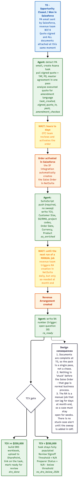
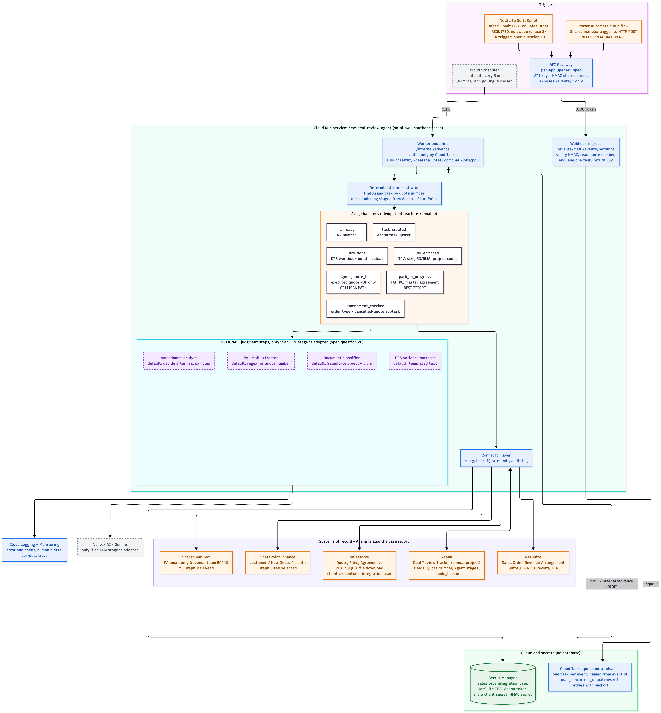
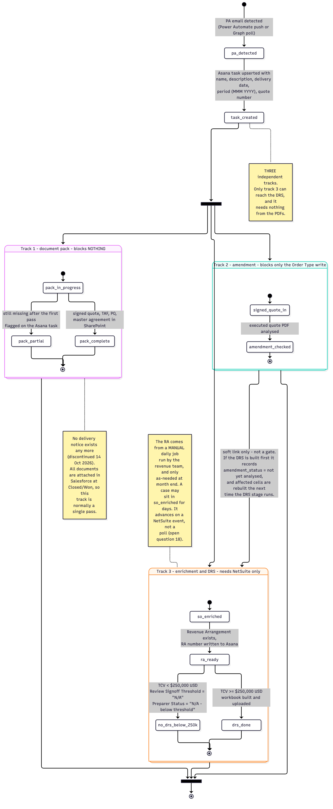
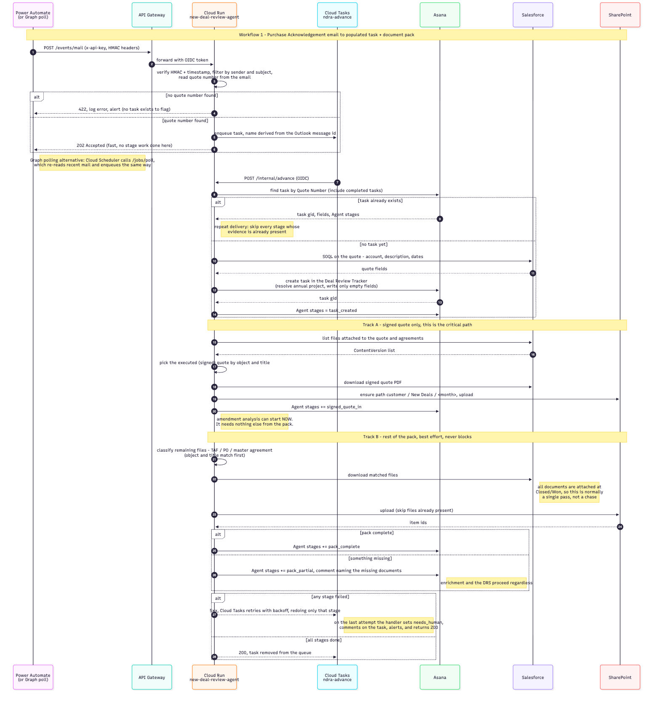
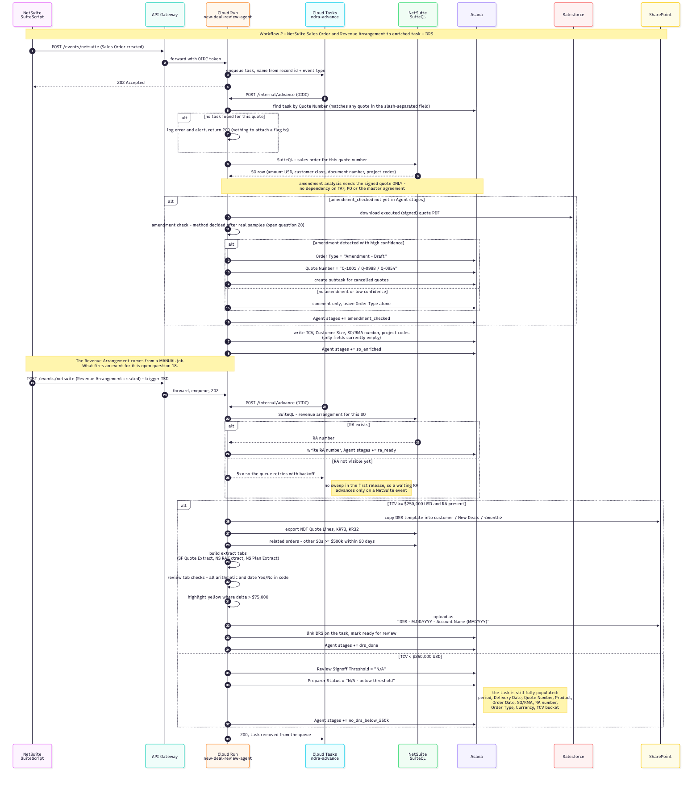
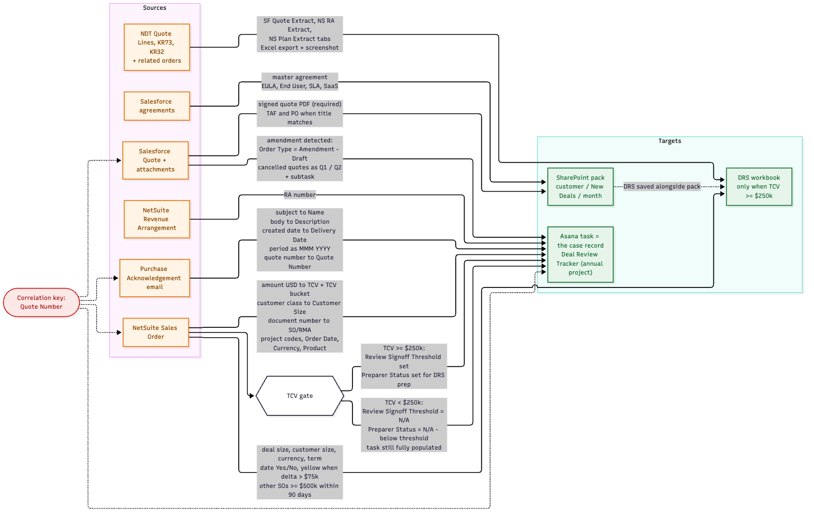
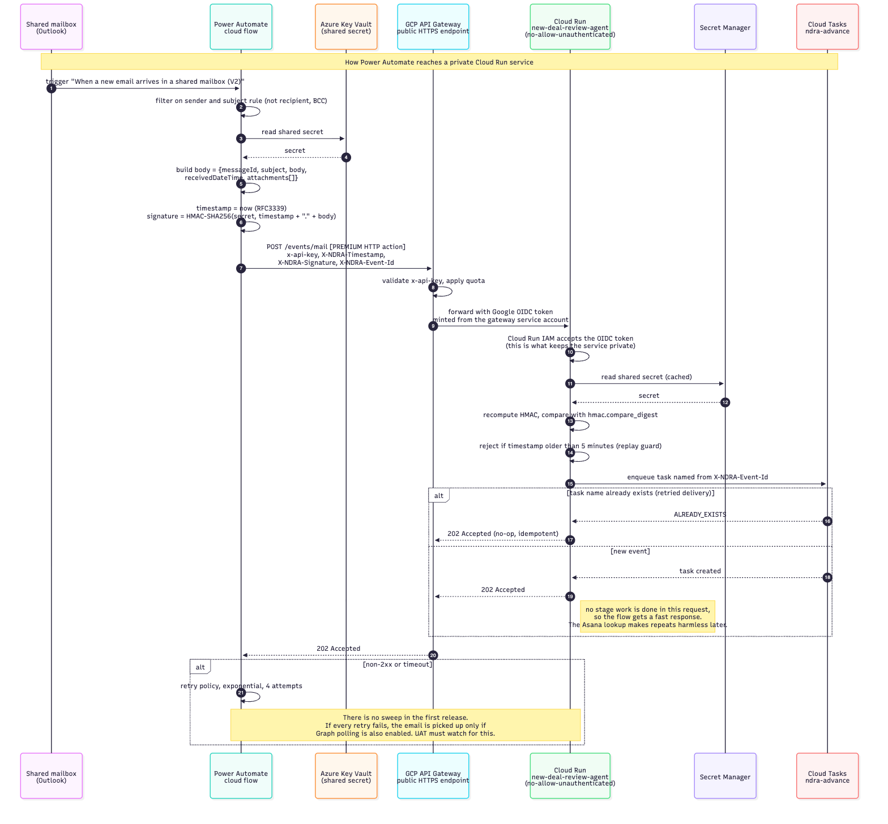
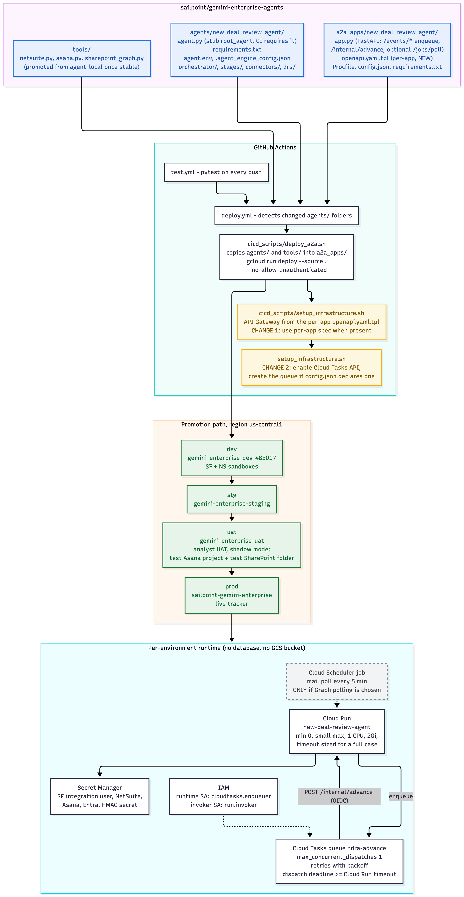

# New Deal Review Agent — Design and Delivery Plan

**Jira:** [ITAI-1270 — New Deal Review](https://sailpoint.atlassian.net/browse/ITAI-1270) (source: [ITFINSYS-673](https://sailpoint.atlassian.net/browse/ITFINSYS-673))
**Repo:** `sailpoint/gemini-enterprise-agents`
**Proposed runtime:** Cloud Run service `new-deal-review-agent`, region `us-central1`
**Status:** draft for review

---

## 1. Summary

A Revenue Analyst today assembles every new deal by hand across email, Asana, Salesforce, NetSuite, and SharePoint. This agent automates that intake end to end.

Two business workflows:

1. **Purchase Acknowledgement email arrives** — create and populate a task in the Deal Review Tracker in Asana, then collect the document pack (signed quote, TAF, PO, master agreement) into SharePoint under `customer / New Deals / <month>`.
2. **NetSuite sales order is created** — match it to the task by quote number, enrich TCV, customer size, SO/RMA and project codes, analyse the executed: quote for amendment language, and once the Revenue Arrangement exists and TCV is at least $250,000 USD, build and upload the Deal Review Sheet workbook.

The decisive design point is that **this is not a conversational agent**. Nobody prompts it. It is triggered by events and does its work inline when each event arrives. State lives in Asana, so there is no database, queue, or scheduled sweep in the first release. A scheduled catch-up sweep is deferred to UAT (section 5). That shape is what drives the runtime recommendation below.

### Constraints from the source ticket
i
[ITFINSYS-673](https://sailpoint.atlassian.net/browse/ITFINSYS-673) (parent: ITFINSYS-557 "Revenue - Contract AI", reporter Amanda Fausnacht, currently On Hold) adds three facts the deck does not cover. All three change the build.

1. **The Asana project is annual, not quarterly, and is being renamed.** Per the 11 Sep 2026 meeting notes, each Deal Review Tracker project covers Q2 Y1 to Q1 Y2 — for example 1 May 2026 to 20 Apr 2027 — to line up with the annual review thresholds that happen in Q1. The apostrophe is being removed from the name and a new convention chosen so it rolls forward cleanly each year. **The agent must therefore never hardcode "FY'27 Deal Review Tracker".** It resolves the project at runtime from a configurable name pattern plus the deal's date, and fails loudly to `needs_human` if no project matches, rather than silently writing into last year's tracker.
2. **SharePoint is getting a new parent folder.** The Finance team will create a new parent to house the historical 2024 Invoices folder and its subfolders, and that new parent is where the integration creates a folder per customer, keyed on a unique identifier. So the customer folder is matched on **the unique identifier, not the display name** — which also resolves the duplicate-company-name worry from the deck.
3. **The integration user is still unresolved.** The 19 Oct 2026 comment records that further internal discussion is needed to configure a new integration record and user. This confirms the dependency flagged in the risks table and is the single most likely cause of a Phase 0 slip.

The ticket has been on hold since Jun 2026 pending Data Engineering input, so the Phase 0 access work is as much about unblocking that as it is about credentials.

---

## 1b. Confirmed process timeline



Amanda Fausnacht has now answered the deck's open questions. Her answers change the design in five material ways.

### There is no delivery notice any more

**As of 14 Oct 2026 no delivery notice emails are sent for any deals.** It is gone from the document pack, the data map, the state model, the retry logic and the SharePoint upload. Everything the earlier draft said about chasing a late or missing delivery notice is obsolete and has been deleted rather than marked optional.

### The documents are all there at the moment the PA email fires

The PA email is sent by Salesforce when the opportunity is closed. The quote is signed and finalised at that same moment, and **every document the agent needs is attached to the relevant Salesforce objects at Closed/Won**.

That makes the document pack a single pass rather than a chase. The two-track model in section 4 still stands, because the amendment check genuinely only needs the signed quote and there is no reason to couple it to anything else, but in practice both tracks will complete on the first run. The retry machinery becomes a safety net rather than the normal path, which is a meaningfully simpler system to operate.

### The revenue team is BCC'd, so mailbox filtering cannot use To or CC

The PA email reaches the revenue team by BCC. Their address does not appear in the message headers. **The agent must therefore identify PA emails by sender plus subject pattern, never by recipient**, and the same is true of any Power Automate flow trigger condition. The sample attached to the ticket is titled "Fidelity Investments - Purchase Acknowledgement for SailPoint Offerings", which suggests a stable `<Account> - Purchase Acknowledgement for SailPoint Offerings` subject shape worth confirming across more samples.

### The Revenue Arrangement is a manual daily job, and this drives the alerting design

The sequence after the quote is signed is: the OTC team reviews and activates the order, which takes **hours to days**; order activation in Salesforce automatically creates the Sales Order in NetSuite; then the revenue team **manually triggers a NetSuite job** to create Revenue Arrangements, typically daily but only as-needed at month end.

So a case sitting in `so_enriched` waiting for an RA is normal and can legitimately last for days. The earlier draft's "alert if any case is non-terminal for more than 24 hours" would have paged on healthy deals every single month end. Alert thresholds are now per stage, and the `so_enriched → ra_ready` wait is explicitly exempt from the generic stuck-case alert. See section 11.

### Below $250k is an action, not a stop

The earlier draft treated `no_drs_below_250k` as "stop, do nothing". It is not. The Asana task is still fully populated — period, Delivery Date, Quote Number, Product, Order Date, Sales Order/RMA Number, Revenue Arrangement Number, Order Type, Currency and TCV bucket — and then two fields are set explicitly:

| Field | Value |
|---|---|
| Review Signoff Threshold | `N/A` |
| Preparer Status | `N/A - below threshold` |

Note that this answer also introduces Asana fields the deck never mentioned: **Product, Order Date, Currency, TCV bucket, Review Signoff Threshold and Preparer Status**. The field list in section 6 has been extended, and "TCV bucket" in particular needs confirming — it reads like a picklist derived from the raw amount rather than the amount itself.

### Two smaller answers

A fully executed quote PDF **cannot** be modified or overwritten in Salesforce once uploaded. That removes the content-hash-and-reanalyse machinery the earlier draft proposed: the amendment analysis runs once and the result is final.

A SuiteScript to trigger the agent on sales order creation **is possible**, which upgrades the NetSuite push from speculative to planned. See section 7.

### Reference material now on the ticket

Three attachments on [ITFINSYS-673](https://sailpoint.atlassian.net/browse/ITFINSYS-673) are the starting point for Phase 0 and should be pulled into the repo as test fixtures:

| File | Use |
|---|---|
| `Fidelity Investments - Purchase Acknowledgement for SailPoint Offerings.pdf` | First entry in the PA email fixture corpus |
| `DRS - 2.27.2026 - Fidelity Investments (03.2026) (1).xlsx` | The golden-file target for the DRS builder, and the authoritative tab and cell layout |
| `Revenue Contract AI - Discovery Session (1).docx` | Discovery notes, to cross-check against this plan |

---

## 2. Why Cloud Run and not Agent Engine

Every other agent in this repo deploys to Vertex AI Agent Engine, which is the right default for a chat agent invoked from Gemini Enterprise. It is the wrong fit here, for these concrete reasons.

| Requirement | Agent Engine | Cloud Run |
|---|---|---|
| Receive webhooks from NetSuite SuiteScript and Power Automate (or Microsoft Graph polling) | No HTTP ingress you control | Native, plus API Gateway in front |
| Durable state across days | Session state is per-conversation | Not needed from the platform: state lives in Asana (section 4) |
| Scheduled catch-up work | No scheduler concept | Cloud Scheduler is available when we add the sweep (section 5, deferred to UAT) |

There is no database and no queue. Each trigger is processed inline, and nothing in the service creates or depends on a conversation session.

The repo already has a Cloud Run path: `a2a_apps/rag_agent_product` deploys through `cicd_scripts/deploy_a2a.sh` with `gcloud run deploy --source .` and buildpacks, service account read from `.agent_engine_config.json`, and `--no-allow-unauthenticated`. We reuse it with **one pipeline change**: a per-app OpenAPI spec (section 9), because the shared `cicd_scripts/openapi.yaml.tpl` only exposes A2A paths and would not route `/events/*` through API Gateway. No Dockerfile is needed.

CI only reacts to edits under `agents/`, and `deploy_a2a.sh` reads the service account from `agents/<name>/.agent_engine_config.json`. So `agents/new_deal_review_agent/` must exist. In the first release it is a **stub**: a minimal `root_agent`, `requirements.txt`, and `.agent_engine_config.json`. The Cloud Run app does not import it, so no ADK session is ever created. If a model-backed stage is added later (section 3), it lives in that folder. Whether any LLM stage is needed at all is an open decision (section 15).

---

## 3. Architecture



### The control-flow rule

**The LLM never drives the state machine.** The orchestrator is plain, testable Python. The model is called only for the four judgment tasks that genuinely need it.

| Call | Why a model | Guardrail |
|---|---|---|
| PA email extraction (name, description, delivery date, period, quote number) | Free-text email bodies, no fixed template | Structured output schema; confidence threshold; below threshold the case goes to `needs_human` |
| Document classification (signed quote / TAF / PO / master agreement) | File titles are inconsistent; a master agreement may be EULA, End User, SLA, or SaaS | Deterministic title match tried first, model only as fallback |
| Amendment analysis of the executed quote PDF | Requires reading contract language and pulling cancelled quote numbers | High threshold; below it, comment on the task and leave `Order Type` alone rather than guessing |
| DRS review-tab narrative and date Yes/No checks | Judgement on variance | All arithmetic (TCV, $75k delta, $500k/90-day scan) is computed in code, not by the model |

Everything else — Asana field writes, SharePoint folder creation, NetSuite queries, Excel generation, the $250k threshold, yellow highlighting — is deterministic code. That is what makes the system auditable, which matters because it touches revenue records.

### Components

- **FastAPI ingress** (`a2a_apps/new_deal_review_agent/app.py`): `/events/mail`, `/events/netsuite`, `/healthz`, `/deals/{quote_number}` (reads the stage ledger from Asana). `/jobs/poll` exists only if Graph mail polling is chosen over Power Automate (section 7a); Cloud Scheduler would call it. There is no `/jobs/reconcile` and no `/internal/advance` in the first release.
- **Orchestrator**: handles one event inline. It finds the Asana task by quote number, builds the case view from Asana and SharePoint, and runs the stages whose evidence is missing. There is no queue and no background work.
- **Stage handlers**: one module per stage, each with `is_satisfied(case)` and `execute(case)`. Both are idempotent and safe to re-run, which is what makes a retried trigger harmless.
- **Connector layer**: one adapter per system of record, handling retries, backoff, rate limits, and an audit log line per external write.
- **State: Asana only.** There is no database. The Asana task, keyed by a Quote Number custom field, is the case record. Stage evidence comes from Asana fields plus SharePoint contents. See section 4.
- **Temporary files**: downloaded PDFs and the generated workbook are held in `/tmp` for the duration of the request (in-memory on Cloud Run, so size the service memory for them). The DRS template is fetched from SharePoint each run. No GCS bucket in the first release.

---

## 4. Stage model



### The amendment check needs only the signed quote

The deck's stage list reads `task_created → docs_in_progress → amendment_done → ...`, which implies the whole document pack has to land before the amendment check can run. **That is the wrong dependency.**

The amendment check reads exactly one artefact: the executed (signed) quote PDF. The TAF, the PO and the master agreement tell it nothing about amendment language. Coupling the `Order Type` write — and everything downstream of it, including the DRS — to documents it does not need is a stall waiting to happen.

**The signed quote does not gate the DRS either.** The DRS is built entirely from structured data: the Salesforce quote lines, the NetSuite RA and plan extracts, TCV, customer size, currency, term, and the related-orders scan. Nothing in it is read out of the signed PDF. So the signed quote gates the amendment check and nothing else.

The model therefore splits into **three independent tracks** that run in parallel after `task_created`:

| Track | Stages | Needs | Blocks what |
|---|---|---|---|
| **1 — document pack** | `pack_in_progress → pack_complete` or `pack_partial` | Signed quote, TAF, PO, master agreement from Salesforce | Nothing. If the pack is incomplete after the first pass, flag it on the task |
| **2 — amendment** | `signed_quote_in → amendment_checked` | The executed quote PDF only | Only the `Order Type` and cancelled-quote writes |
| **3 — enrichment and DRS** | `so_enriched → ra_ready → drs_done` or `no_drs_below_250k` | NetSuite SO and RA | Nothing upstream. Runs even if the PDFs never arrive |

The one real coupling is soft, and it is worth handling explicitly rather than by blocking: if an amendment is found, `Order Type` becomes `Amendment - Draft` and the cancelled quote numbers change which quotes are in scope. If the DRS is built before the amendment check has finished, the workbook records `amendment_status: not yet analysed` so the reviewer can see it, and the DRS stage rebuilds the affected cells the next time it runs after the check completes. In practice this almost never fires, because the signed quote is present from the moment the PA email arrives while the RA is days behind — track 2 will have long since finished.

Since every document is attached at Closed/Won, all three tracks normally finish without incident. The split earns its keep on the exception: a misfiled TAF, or a signed quote the classifier cannot identify, no longer stops a $2m deal from getting its DRS.

### Everything else about the model

Stages otherwise follow the deck, terminating at `no_drs_below_250k` when TCV is under $250,000 — which, per section 1b, means setting Review Signoff Threshold to `N/A` and Preparer Status to `N/A - below threshold` on an otherwise fully populated task, not doing nothing.

### Where state lives: Asana, no database

There is no app-owned database. The Asana task is the case record, and stage status is **derived from evidence every time an event arrives**, not stored as a cursor.

| What the plan needs to know | Where it comes from |
|---|---|
| Does a case exist for this deal? | An Asana task whose **Quote Number** custom field matches. The lookup must include completed tasks, otherwise the agent recreates a task once an analyst completes it |
| Which stages are done? | Asana fields (`Order Type` set means `amendment_checked`, the SO/RA numbers mean `so_enriched`/`ra_ready`) plus SharePoint contents (the customer folder holds the pack, the DRS file means `drs_done`). Stages with no visible trace use one agent-owned custom field, **Agent stages**, holding a short string such as `task_created,amendment_checked` |
| Is a case stuck or blocked? | An Asana tag or enum field `needs_human`, plus a comment naming exactly what is missing |
| Is the case open or closed? | The task's own completed flag |
| How long has it been waiting? | The task's `created_at`, which is close to the PA email time |
| History for support | Cloud Logging. Every log line carries `quote_number`, `case_id`, `stage` and `attempt` (section 11) |

Consequences to accept knowingly:

- **Duplicate tasks.** Asana has no atomic create-if-absent. Two simultaneous triggers for the same quote could both find nothing and both create a task. The service is therefore deployed with **`max_instances: 1`** and a lock around the lookup-and-create, so triggers are processed one at a time. At tens of deals this is ample. Two revisions briefly overlap during a deploy, which leaves a very small residual risk.
- **Failures before a task exists.** If the quote number cannot be extracted, there is no task to carry `needs_human`. The service logs an error, and a log-based alert fires.
- **A missed trigger is not caught automatically** in the first release. See section 5.
- **Required Asana setup.** A Quote Number field, an Agent stages field, and a `needs_human` marker must exist on the Deal Review Tracker project. An Asana admin has to add them. See open question 19.

This is still what makes a duplicate delivery harmless. Handlers are idempotent, so a retried trigger finds the existing task and does nothing it has already done.

Writes to Asana are **field-level upserts that only populate empty fields**, matching the deck's "populate the empty fields" requirement. The agent never overwrites an analyst's manual correction.

---

## 5. Workflow sequences

### Workflow 1 — PA email to populated task and document pack



### Workflow 2 — NetSuite sales order and revenue arrangement to enriched task and DRS



### Triggers, retries and what happens on failure

Each trigger is handled **inline**: the request finds or creates the Asana task, runs the stages whose evidence is missing, and returns. There is no queue, no background worker, and no scheduled sweep in the first release.

- **Workflow 1** is triggered by the PA email, through a Power Automate flow or Graph polling (section 7a). Every document is attached at Closed/Won, so the work is one pass: create and populate the task, then copy the pack to SharePoint.
- **Workflow 2** is triggered by NetSuite SuiteScript events (section 7a).
- **Failures return an error to the caller.** A 5xx makes Power Automate or the SuiteScript retry, and idempotent handlers make the retry safe. A stage that fails after the task exists leaves its evidence unset, so the next trigger redoes only that stage. A stage that cannot succeed (for example a missing document) sets `needs_human` and comments on the task.
- **Request time.** The work must fit inside the gateway deadline, the Cloud Run request timeout, and Power Automate's HTTP action timeout (about two minutes for a synchronous call; confirm with IT). Workflow 1 is a handful of Salesforce, Asana and SharePoint calls and should fit. If a stage outgrows that, return `202` and move the work to a background mechanism such as Cloud Tasks. That is a later change, not a first-release component.

### Deferred: the catch-up sweep

A scheduled sweep that re-checks open tasks and finishes whatever is outstanding is **intentionally not built now**. Salesforce attaches every document before the PA email is sent, and each event carries what the stage needs, so the sweep is only a safety net for missed triggers. It is added during UAT if monitoring shows triggers being missed.

When it is added, it needs only Cloud Scheduler calling one endpoint with an OIDC token. The endpoint lists incomplete Asana tasks (`completed_since=now`) and runs the same stage handlers over them within a time budget, stopping when the budget runs out so the next run resumes. No database or queue is required, because stage status is derived from Asana and SharePoint each time.

Until then, two things the sweep would have covered have no automatic catch-up:

- **A missed or failed trigger.** Power Automate and the SuiteScript retry, and a handled event can be replayed by posting the same payload to `/events/mail` or `/events/netsuite`, but nothing detects a trigger that never fired.
- **Waiting stages.** A deal waiting days for a Sales Order or Revenue Arrangement is moved forward by the NetSuite event, not by a poll. **This makes the Revenue Arrangement trigger a hard dependency: see section 7a and open question 18.**

---

## 6. Data map



**Quote number is the correlation key** across all five systems. Everything else hangs off it. Two consequences worth calling out now:

- The Asana task is keyed by the normalised quote number in its Quote Number custom field, so looking the task up before creating it gives us idempotency for free.
- Amendments break the one-to-one assumption, since cancelled quotes are folded into a single Quote Number field separated by forward slashes. The case therefore treats the first number as the primary quote and the rest as cancelled quotes parsed from that field, and lookups match on any of them.

---

## 7. Integrations and authentication

| System | Access | Auth | Repo precedent |
|---|---|---|---|
| Shared mailbox or alias (PA email) | Graph `/users/{mailbox}/messages` delta query, filtered on sender and subject since the revenue team is BCC'd | Entra app, client credentials, `Mail.Read` application permission scoped to the single mailbox via an Application Access Policy | New |
| SharePoint (Finance site) | Graph `/sites/{id}/drives/.../items` | **Reuse the existing `job_capabilities_agent` Entra app**, adding a `Sites.Selected` grant for the Finance site | `agents/job_capabilities_agent/tools/sharepoint.py` (tenant `9c848b2a-…`, secrets `SHAREPOINT_CLIENT_ID` / `SHAREPOINT_CLIENT_SECRET`) |
| Salesforce — metadata and queries | Hosted MCP, read-only SObject tools | Bearer token | `tools/salesforce_mcp.py` — **but see the caveat below** |
| Salesforce — file downloads | REST `ContentVersion/{id}/VersionData`; SOQL through `/services/data/<ver>/query` | OAuth client-credentials flow for the **New Deal Review integration user**; client ID and secret in Secret Manager | Ported from the `deal_review_agent_wf1` prototype (`app/integrations/salesforce`). Not `tools/quote_validation_tool.py`, which uses a different integration user |
| NetSuite | SuiteQL for reads, REST Record for detail | Token-based auth (OAuth 1.0a HMAC-SHA256) as an integration user | **New — no NetSuite integration exists in the repo today** |
| Asana | REST `/tasks` in the Deal Review Tracker, project resolved at runtime | Service-account PAT in Secret Manager | **New** |
| DRS workbook | `openpyxl` against a template copied from SharePoint, uploaded back via Graph | — | `tools/sox_audit_trail_excel_helpers.py` |
| Gemini | Vertex AI through ADK | Cloud Run service account | Repo-wide |

`Sites.Selected` rather than `Sites.ReadWrite.All`, and an Application Access Policy on the mailbox, are both non-negotiable for security review. Request them in Phase 0 because the Entra grant is usually the long pole.

### Reusing the job_capabilities_agent Entra app

`Sites.Selected` is designed for exactly this: permissions are granted per site, so adding the Finance site to the existing app is a single additional grant rather than a new app registration and a new approval cycle. Since this agent is the only consumer of the Finance site, that is the pragmatic choice and the plan assumes it.

Two consequences to accept knowingly:

- **Blast radius.** One client secret then opens both the HR HRBP site and the Finance deal documents. Both agents already run in the same GCP project and read the same Secret Manager entries, so the practical separation was always weak, but it is worth stating in the access request rather than discovering at review.
- **Mail.Read is a different matter.** Adding `Mail.Read` to that app means the HR agent's credentials can also read the deal mailbox. If the security review pushes back on anything, it will be this. Propose the combined grant first; if challenged, split the mailbox into its own app registration and keep SharePoint shared.

### A caveat on the Salesforce Hosted MCP

The MCP server at `api.salesforce.com/platform/mcp/v1/...` is a good fit for the query side — finding the quote by number, listing attached files, reading related records. Two things stop it being the whole Salesforce story here.

**It cannot return file bytes.** The MCP exposes SOQL and record reads. The signed quote PDF lives in `ContentVersion.VersionData`, which is a binary REST endpoint, not something SOQL returns. Downloading the executed quote for amendment analysis needs plain REST regardless, so the connector keeps a REST path alongside the MCP one.

**The repo's existing MCP wiring assumes an interactive user, and this agent has none.** `tools/salesforce_mcp.py` pulls its bearer token from Gemini Enterprise session state via `get_session_auth_token`. That works for a chat agent where a human has authorised Salesforce. This agent is triggered by webhooks with no user and no session, so it must mint its own token for the integration user and pass that to the MCP endpoint instead. Worth a short Phase 0 spike to confirm the Hosted MCP accepts an integration-user token.

Also note the URL under consideration ends in `sobject-all` rather than `sobject-reads`. The repo deliberately filters mutation tools out of the toolset; since this agent only ever reads from Salesforce, point it at the reads server and keep that property by construction rather than by filter.

---

## 7a. Getting a Power Automate flow to reach Cloud Run



### Cloud Run does accept inbound requests — the constraint is authentication

A quick correction to a common assumption: Cloud Run is a normal public HTTPS endpoint and accepts inbound requests from anywhere on the internet. There is no GCP rule against ingress.

What stops Power Automate today is **authentication, not ingress**. This repo deploys Cloud Run with `--no-allow-unauthenticated`, which means every request must carry a Google-signed OIDC token whose audience is the service URL. Google's own services, such as Cloud Scheduler, mint those tokens automatically. Power Automate cannot — its HTTP action has no way to sign a Google token without a custom connector or an Azure Function in the middle, which is more machinery than this is worth.

So we need a doorway that is public to Power Automate but still presents a proper Google identity to Cloud Run. That is exactly what API Gateway does, and the repo already has the wiring for it in `cicd_scripts/setup_infrastructure.sh` from the `rag_agent_product` deployment.

### The recommended shape

```
Power Automate  --HTTPS + API key + HMAC-->  API Gateway  --OIDC token-->  Cloud Run (stays private)
```

Three layers, each doing one job:

1. **API key** on the gateway. Cheap filter, gives us per-caller quotas, and lets us revoke Power Automate without touching the service.
2. **HMAC shared secret**, verified in our own code. This is the real authentication. It proves the request came from our flow and that the body was not altered.
3. **OIDC**, minted by the gateway's service account. This is what lets Cloud Run keep `--no-allow-unauthenticated`, so nobody can bypass the gateway and hit the service directly.

### How the shared secret works, concretely

Generate a long random string once per environment. Store it in GCP Secret Manager for the service, and in Azure Key Vault for the flow to read. Never paste it into the flow definition — Power Automate flow definitions are visible to anyone who can open the flow.

On every POST the flow sends three headers:

| Header | Value |
|---|---|
| `X-NDRA-Timestamp` | current time, RFC3339 |
| `X-NDRA-Signature` | `HMAC-SHA256(secret, timestamp + "." + raw_body)`, hex encoded |
| `X-NDRA-Event-Id` | the Outlook message id, used for deduplication |

Cloud Run then does four checks, in this order, and rejects with 401 on any failure:

1. Recompute the HMAC over the **raw** request body — not the parsed JSON, because re-serialising changes the bytes and breaks the signature.
2. Compare using `hmac.compare_digest`, never `==`, so the comparison is constant-time.
3. Reject if the timestamp is more than five minutes old. This is the replay guard; without it a captured request stays valid forever.
4. Look up the quote number in Asana. If a task already exists, the handler skips every stage whose evidence is present, so a retried delivery does nothing it has already done. `X-NDRA-Event-Id` is logged on every line for tracing and is not stored.

The endpoint does the work inside the request and returns `200` when the stages finish, or a `5xx` on failure so the flow retries. Keep the gateway deadline and Cloud Run timeout under Power Automate's synchronous HTTP timeout (about two minutes; confirm with IT). If a stage outgrows that, switch to `202` with background work (section 5).

Rotation is a two-step: add the new secret as a second accepted value, switch the flow over, then remove the old one. The verifier accepts either during the overlap.

### Licensing: the HTTP action is a premium connector

**This is a real blocker and it is not currently documented anywhere in Confluence.**

The generic `HTTP` action that Power Automate needs in order to POST to an arbitrary URL is a **premium connector**. It requires a Power Automate Premium (per-user) or Process (per-flow) licence. The standard Microsoft 365 entitlement does not include it.

What I found searching Confluence:

| Page | What it tells us |
|---|---|
| [Grooming: Power Automate](https://sailpoint.atlassian.net/wiki/spaces/~71202024a6ed75395d4d029aa831731f0bd6b9/pages/4639524900/Grooming+Power+Automate) (Feb 2026, personal space) | A pricing and plan comparison written while evaluating Power Automate against UiPath. Its table confirms Free Trial gives **standard connectors only**, and that premium and custom connectors need the paid Premium plan. It is an evaluation, **not a record of a purchase.** |
| [IT › Power Automate Flows](https://sailpoint.atlassian.net/wiki/spaces/IT/pages/5264998442/Power+Automate+Flows) (updated Sep 2026) | An inventory of roughly twenty live production flows across Software Support, SaaS Support, Payroll, Marketing and Interns, all running under the `sp-buyer-repo@sailpoint.onmicrosoft.com` service account. |

**There is no Confluence page stating that SailPoint holds a Power Automate premium subscription.** The closest thing to evidence is indirect: several of the live Marketing flows post messages to Slack, and the Slack connector is itself a premium connector. That strongly suggests a premium licence exists on the `sp-buyer-repo` service account, but it is an inference from a flow inventory, not a licensing record, and it should not be built on until someone confirms it.

**Action:** ask IT to confirm whether `sp-buyer-repo@sailpoint.onmicrosoft.com` — or whichever service account would own this flow — carries a Power Automate Premium or Process licence, and whether the HTTP action is permitted under the tenant's DLP policy. Even with a licence, a DLP rule that blocks the HTTP connector from sending business data to non-Microsoft endpoints would stop this cold, and that is a separate check worth making at the same time.

### Trigger strategy: poll is the baseline, push is the accelerator

Given the licensing uncertainty, the plan does not depend on Power Automate.

There are two ways to get the PA email to the service. IT has been asked which it prefers (the Power Automate request and the Graph `Mail.Read` alternative).

**Power Automate push, needs premium.** The flow posts a normalised payload to the gateway the moment a qualifying email arrives. No Cloud Scheduler job is needed. It avoids the Entra `Mail.Read` application grant for the *trigger*, though Graph is still needed for SharePoint uploads, so the Entra app registration does not go away. The flow's trigger condition must filter on sender and subject, not recipient, for the BCC reason in section 1b. Without a sweep, there is no catch-up if a flow run fails permanently, which is the one thing UAT must watch for.

**Graph polling, needs no licence.** A Cloud Scheduler job calls `/jobs/poll` every five minutes. The job re-reads the last day or two of mail from the shared mailbox, filtered by sender and subject, and passes each message through the same idempotent handler. Because it re-reads a window instead of keeping a delta token, it needs no stored watermark and catches triggers a previous run missed. This is the only scheduler job in the first release, and it exists only if this option is chosen.

The ingest endpoint takes a **normalised payload** that either source can produce, so swapping between them is configuration rather than a rewrite.

### NetSuite: SuiteScript push is confirmed viable

Amanda has confirmed a SuiteScript to trigger the agent on sales order creation is possible. With no sweep in the first release, **this is no longer optional**: it is the only thing that starts Workflow 2, so it moves from Phase 5 into the NetSuite phase (section 12). It needs admin change control and its own release cycle, and ITFINSYS-673 records the integration user as unresolved, so request it early.

**The Revenue Arrangement has no hook yet.** The SO is created automatically when the order is activated in Salesforce, so an `afterSubmit` hook fires at a well-defined moment. The RA comes from a job the revenue team runs by hand, typically daily and only as-needed at month end. Earlier drafts relied on polling to discover it. With the sweep deferred, the DRS stage needs something to start it. Options, to be decided with the NetSuite admin (open question 18):

1. A user-event script on the Revenue Arrangement record, if NetSuite allows one. This would be the cleanest answer and is unverified.
2. The sweep, brought forward only for deals that are waiting on an RA.
3. The revenue team triggers it themselves, for example by a button or an email, after running the RA job.

Until one of these is confirmed, the DRS stage cannot be scheduled with confidence.

---

## 8. Repository layout

```
agents/new_deal_review_agent/
  agent.py                      # stub root_agent in the first release (CI requires it); judgment sub-agents only if an LLM stage is adopted
  agent_instructions.py         # only if an LLM stage is adopted
  requirements.txt
  agent.env, agent.main.env
  .agent_engine_config.json     # service account, also read by deploy_a2a.sh
  orchestrator/
    case.py                     # DealCase view built from the Asana task and SharePoint evidence
    engine.py                   # compute missing stages and run them inline, under a lock
  stages/
    task_created.py
    signed_quote.py             # track A, gates amendment and DRS
    amendment.py                # needs the signed quote only
    document_pack.py            # track B, best effort, never blocks
    so_enrichment.py
    ra_ready.py
    drs.py
  connectors/
    graph_mail.py
    sharepoint.py               # customer folder keyed on unique id
    salesforce.py
    netsuite.py
    asana.py                    # resolves the annual project by name pattern
  ingress/
    hmac.py                     # shared-secret verification, replay guard
    normalise.py                # Power Automate and Graph to one payload shape
  drs/
    builder.py                  # extract tabs, review tabs, highlighting
    naming.py                   # "DRS - M.DD.YYYY - Account (MM.YYYY)"

a2a_apps/new_deal_review_agent/
  app.py                        # FastAPI: /events/* webhooks, optional /jobs/poll for Graph mail polling
  openapi.yaml.tpl              # per-app API Gateway spec: only /events/* behind the API key
  Procfile                      # web: uvicorn app:ndra_app --host 0.0.0.0 --port $PORT
  config.json                   # min 0, max 1 (serialises task creation), 1 CPU, 2Gi, timeout under the Power Automate limit
  requirements.txt
```

Connectors start agent-local. Promote `netsuite.py`, `asana.py`, and `sharepoint_graph.py` into shared `tools/` once a second consumer appears, not before.

---

## 9. Deployment and environments



Deployment uses the repo's existing flow with two small changes: push to `dev`, `test.yml` runs pytest, `deploy.yml` detects the changed `agents/` folder, and `deploy_a2a.sh` copies `agents/` and `tools/` into the app directory and runs `gcloud run deploy --source .`. Promotion is `dev → stg → uat → main(prod)` against `gemini-enterprise-dev-485017`, `gemini-enterprise-staging`, `gemini-enterprise-uat`, and `sailpoint-gemini-enterprise`.

### Pipeline change: a per-app OpenAPI spec

API Gateway is configured from an OpenAPI file that lists which paths exist. `cicd_scripts/setup_infrastructure.sh` always uses the shared `cicd_scripts/openapi.yaml.tpl`, which only defines the A2A paths (`/`, `/.well-known/agent-card.json`, `/.well-known/agent.json`). Routes such as `/events/mail` would not exist at the gateway.

The change is additive: if `a2a_apps/<name>/openapi.yaml.tpl` exists, the script uses it, and otherwise it falls back to the shared template. Other agents are unaffected. Our spec exposes only `/events/mail` and `/events/netsuite`, each with `security: api_key_auth` and an `x-google-backend` entry pointing at the Cloud Run URL. `/healthz` and `/jobs/*` are not exposed publicly; Cloud Scheduler, if used, calls Cloud Run directly with OIDC. The script also writes `A2A_PUBLIC_URL` into the service, which is unused here and harmless.

### Infrastructure to provision

New per-environment infrastructure, one-time and scripted:

- Secret Manager entries for the credential sets (Salesforce integration user, Asana, Microsoft Entra, NetSuite, and the Power Automate HMAC secret)
- The Asana custom fields and `needs_human` marker on the Deal Review Tracker project (section 4)
- A separate Asana test project and a test SharePoint folder for shadow mode
- A Cloud Scheduler job calling `/jobs/poll`, only if Graph mail polling is chosen over Power Automate

There is no Firestore database, no Cloud Tasks queue, and no GCS bucket.

### Shadow mode

Shadow mode points the same code at **test targets**, not a no-op. A flag that turns every external write into a logged no-op cannot work here, because state lives in Asana. If nothing is written, no task exists, so every later trigger looks like a brand-new deal. Stage status never advances, Workflow 2 finds no task to match, and the same work is redone on every event.

Instead, per environment, the Asana project and the SharePoint root are configuration:

- **Shadow:** a separate Asana test project and a test SharePoint folder. The agent writes for real, but only there. Analysts compare the test project against the live tracker for about two weeks to see what the agent would have done against what they actually did. This is how we earn the right to point it at the live tracker.
- **Live:** the real Deal Review Tracker project and the Finance SharePoint root.

The switch is one setting (the project name pattern and the SharePoint root), not a code path.

---

## 10. Testing

Following `AGENTS.md`: unit tests for isolated logic, integration tests for anything crossing a boundary, and no mocked database responses — data retrieval is decoupled behind the connector interfaces so tests inject fakes.

- **Unit**: each stage's `is_satisfied` and `execute` against fake connectors; the $250k threshold; the $75k delta highlighting; the $500k / 90-day related-order scan; DRS filename formatting including the multi-deal case; quote-number normalisation and the slash-separated amendment form.
- **Fixture corpus**: a set of real PA emails, redacted, with expected extractions, kept as the regression suite for the extractor. This is the single highest-value test asset and it depends on getting sample emails in Phase 0.
- **Golden file**: generate a DRS workbook from a frozen input set and diff cell by cell against a checked-in expected workbook. Catches template drift immediately.
- **Integration**: against a Salesforce sandbox, a NetSuite sandbox account, a dedicated Asana test project, and a SharePoint test site. Full happy path plus the out-of-order event path plus the missing-document path.
- **Idempotency**: run the same event twice and assert exactly one Asana task and no duplicate uploads.

---

## 11. Observability and failure handling

Every log line carries `quote_number`, `case_id`, `stage`, and `attempt`. Beyond that:

- **Per-stage alert thresholds, not one global one.** A single "non-terminal for 24 hours" rule would page on healthy deals at every month end, because waiting for the Revenue Arrangement is legitimately slow. Thresholds reflect the confirmed timeline:

| Stage | Expected wait | Alert after |
|---|---|---|
| `task_created`, `signed_quote_in` | seconds | 1 hour |
| `pack_in_progress` | seconds | 72 hours, flag on the task rather than page |
| `amendment_checked` | seconds | 1 hour |
| `so_enriched` (waiting for the SO) | hours to days, OTC review | 5 days |
| `ra_ready` (waiting for the RA) | daily job, as-needed at month end | **14 days, and suppressed entirely in the last 5 days of a month** |
| `drs_done` | minutes once the RA exists | 4 hours |

**These thresholds need something that looks for stuck cases, so they are deferred together with the sweep (section 5).** With only event-driven processing, a deal that is waiting and never receives its next event raises no alert. The thresholds are kept here so they can be applied when the sweep is added in UAT. The alerts that work from day one are the ones raised by an event: a stage that fails, an extraction that finds no quote number, and a `needs_human` set by a handler.

- No retry budget inside the service. A failed stage returns an error so the caller retries, and a stage that cannot succeed sets `needs_human`, comments on the Asana task naming exactly what is missing, and logs an error that fires an alert. The analyst is never left guessing.
- `GET /deals/{quote_number}` returns the stage ledger, built from the Asana task and SharePoint, for support.
- A weekly digest of cases closed, cases blocked, and median time from PA email to `drs_done` — the number that proves the business case.

The agent never approves anything. The DRS is produced *ready for review*; a human still signs off.

---

## 12. Phasing

| Phase | Scope | Estimate |
|---|---|---|
| 0 | Access and credentials (Entra app, `Sites.Selected` grant, SF connected app, NetSuite integration user, Asana token), **confirm Power Automate premium licence and DLP policy**, **confirm the new Asana project naming convention and the new SharePoint parent folder**, sandbox provisioning, collect the PA email fixture corpus | 1 week |
| 1 | Cloud Run skeleton with the per-app OpenAPI spec and the stub agent folder, Asana case lookup and idempotency (Quote Number field, lock, `max_instances: 1`), Graph mail polling or the Power Automate flow, PA email extraction, annual project resolution, `task_created` | 2 weeks |
| 2 | Salesforce file retrieval, signed quote first (`signed_quote_in`), document classification, SharePoint pack keyed on customer unique id (`pack_in_progress`) | 2 weeks |
| 3 | Amendment analysis off the signed quote, cancelled-quote subtask, NetSuite SO matching and enrichment, RA number, **NetSuite SuiteScript push for the SO and a trigger for the RA (open question 18)** — `amendment_checked`, `so_enriched`, `ra_ready` | 2 weeks |
| 4 | DRS workbook: extract tabs, review tabs, highlighting, naming, upload — `drs_done`; plus the below-threshold path (`Review Signoff Threshold` and `Preparer Status` to `N/A`) | 2 weeks |
| 5 | API Gateway with HMAC for Power Automate (if licensed), event-driven alerting, shadow-mode UAT against the test Asana project, **catch-up sweep if UAT shows missed triggers**, production cutover | 1.5 weeks |

Roughly **10.5 weeks** end to end. These estimates were not revisited after removing the database, queue and sweep, and after moving the SuiteScript push into Phase 3. Phases 1 and 2 deliver standalone value — every PA email becoming a populated task with its document pack is most of the manual effort — so there is a credible early release at the end of Phase 2.

---

## 13. Risks

| Risk | Impact | Mitigation |
|---|---|---|
| No NetSuite integration precedent in the repo | Unknown effort in Phase 3 | Spike the TBA auth and a SuiteQL read in Phase 0, before committing to the estimate |
| NetSuite integration user unresolved per ITFINSYS-673 (19 Oct 2026) | Phase 0 slips, Phase 3 blocked | Named owner and a decision date agreed in Phase 0; SuiteQL polling under a read-only user is the interim path |
| Power Automate premium licence not confirmed, and tenant DLP may block the HTTP connector | The push trigger is unavailable | Graph polling is the baseline and needs no licence; the push path is purely additive |
| Asana Deal Review Tracker is being renamed and rolls over annually | Agent writes into the wrong year's project, or stops working at rollover | Resolve the project by configurable name pattern plus deal date; fail to `needs_human` rather than guessing; add a rollover test |
| Entra `Sites.Selected` and mailbox policy grants are slow | Blocks Phases 1 and 2 | Raise the request on day one of Phase 0 |
| Amendment detection from PDF is accuracy-sensitive and writes to a revenue field | Wrong `Order Type` on a real deal | High confidence threshold; below it, comment only and never write; shadow mode measures accuracy before enabling |
| DRS template changes without notice | Silent corruption of the workbook | Golden-file test against the sample workbook on ITFINSYS-673, plus a template checksum logged on every run |
| RA waits are long and irregular, especially at month end | Noisy alerts, or real failures hidden among them | Per-stage thresholds in section 11; the RA wait is exempt from the generic stuck-case alert and suppressed in the last five days of a month |
| Duplicate company names across concurrent deals | DRS filename collision in SharePoint | Largely resolved by ITFINSYS-673: customer folders are keyed on a unique identifier, not the display name. Interim rule for the filename itself is to append the SO number |
| Non-USD orders | TCV threshold evaluated on the wrong number | Read the USD amount field explicitly; fail the case to `needs_human` if absent rather than converting |
| Asana and Salesforce rate limits under backfill | Throttling, partial runs | Serial processing on a single instance, exponential backoff in the connectors, and idempotent handlers so a retried event is safe |
| A missed trigger goes unnoticed, since there is no sweep | A deal is left incomplete with no alert | Power Automate and SuiteScript retries, idempotent handlers, event replay through `/events/*`, and the sweep added in UAT if monitoring shows misses |
| Duplicate Asana tasks from concurrent triggers | Two tasks for one quote | `max_instances: 1`, a lock around lookup-and-create, and a lookup that includes completed tasks |
| No trigger exists for the Revenue Arrangement | The DRS stage never starts | Resolve open question 18 in Phase 0; fall back to a narrow sweep for deals waiting on an RA |
| Asana is the only record of state | Analysts editing or deleting tasks change what the agent believes | Populate-only-empty writes, a dedicated Agent stages field, and idempotent stages that re-derive status from evidence |

---

## 14. Open questions

### Answered by Amanda Fausnacht

| # | Question | Answer and what it changed |
|---|---|---|
| 1 | What does a delivery notice look like, and how often is it missing? | **No delivery notices are sent for any deals as of 14 Oct 2026.** Removed from the design entirely |
| 2 | Can PA emails go to a shared mailbox or alias rather than a personal inbox? | **Agreed in principle**, may need a new one requested. Amanda is checking current Salesforce configuration and existing aliases. *Still needs the specific address before Phase 1* |
| 3 | What is the general timeline, and can events arrive out of order? | Mostly ordered. PA email and signed quote at Closed/Won; OTC review and order activation takes hours to days; order activation creates the SO automatically; the RA comes from a manual daily job, as-needed at month end. Drove the per-stage alert thresholds in section 11 |
| 4 | When is the signed quote PDF attached? Same for TAF, PO, master agreement? | **All documents are attached at Closed/Won.** The pack becomes a single pass, not a chase |
| 5 | What does a PA email look like, with samples? | Sample PDF attached to ITFINSYS-673. The revenue team is **BCC'd**, so filter on sender and subject, never recipient |
| 6 | What happens to deals under $250k? | Task still fully populated; `Review Signoff Threshold` = `N/A`, `Preparer Status` = `N/A - below threshold`. Introduced six Asana fields the deck omitted |
| 7 | Can a fully executed quote PDF be modified or overwritten in Salesforce? | **No.** Removed the content-hash-and-reanalyse machinery; amendment analysis runs once |
| 13 | Can we create a SuiteScript to trigger the agent on sales order creation? | **Yes.** Moves the NetSuite push from speculative to planned. With the sweep deferred it is required, and it is now scheduled for Phase 3 |

### Still open

| # | Question | Proposed default |
|---|---|---|
| 2b | What is the actual shared mailbox or alias address, and does one already exist? | Blocks Phase 1; Amanda is asking the Salesforce team |
| 8 | How should the DRS be named when the same company has multiple deals? | Amanda restated the standard convention, which does not resolve the collision: two deals for the same account with the same order-start month, prepared on the same day, produce **identical filenames**. Rare but possible. Proposed: append the SO number only on collision |
| 9 | Does `sp-buyer-repo@sailpoint.onmicrosoft.com`, or whichever service account owns the flow, hold a Power Automate Premium or Process licence? | Assume not; build Graph polling first |
| 10 | Does tenant DLP allow the HTTP connector to post business data to a non-Microsoft endpoint? | Assume not; confirm with IT alongside question 9 |
| 11 | What is the final Asana project naming convention after the apostrophe is removed, and the exact annual rollover date? | Configurable pattern plus deal date; fail to `needs_human` on no match |
| 12 | What is the unique identifier used for the SharePoint customer folders under the new parent? | Salesforce Account Id unless told otherwise |
| 14 | Is "TCV bucket" a picklist derived from the amount, and what are its boundaries? | Derive in code from the USD amount; confirm the bucket boundaries in Phase 0 |
| 15 | Where do `Product` and `Order Date` come from — the NetSuite SO, the Salesforce quote, or the PA email? | Assume the NetSuite SO; confirm against the sample DRS workbook |
| 16 | What exactly is the `Review Signoff Threshold` field, and what are its values above $250k? | We only know it is set to `N/A` below threshold. Likely an approval tier driven by TCV. The agent cannot populate it correctly above $250k until someone lists the values |
| 17 | Does an Asana service account exist for integrations, and who issues its token? | Asana PATs belong to a user, so this needs either an Asana Enterprise service account or a dedicated licensed integration user. Route via the IT shared-service-account programme |
| 18 | Can NetSuite fire a trigger when a Revenue Arrangement is created, for example a user-event script on the record? | Unknown. Without one, the DRS stage has no start event; fall back to a narrow sweep for deals waiting on an RA, or have the revenue team trigger it after the RA job |
| 19 | Who can add the Quote Number, Agent stages and `needs_human` fields to the Deal Review Tracker project, and can the lookup use Asana task search on our tier? | Ask the Asana admin in Phase 0. If search is unavailable, list the project's tasks once per event and match by field |
| 20 | Is any LLM stage needed (PA email extraction, document classification, amendment analysis, DRS narrative)? | Build deterministic first. Quote number by regex, documents by Salesforce object and title, DRS from computed values. Decide on amendment analysis after reviewing real signed quotes |

---

## 15. Decisions needed to proceed

1. Confirm Cloud Run over Agent Engine (section 2).
2. Confirm Asana as the only state store, with no database, queue or GCS bucket (section 4).
3. Confirm the two-track stage model, in particular that the amendment check runs off the signed quote alone (section 4).
4. Confirm the mail trigger: Power Automate push (needs the premium licence and DLP position) or Graph polling with one Cloud Scheduler job (section 7a). IT has been asked which it prefers.
5. Ask IT to answer open questions 9 and 10 on Power Automate licensing and DLP.
6. Name the owners for the NetSuite integration user (ITFINSYS-673 has this open since 19 Oct) and the Entra app registration.
7. Get the final Asana project naming convention, the SharePoint customer-folder identifier, the TCV bucket boundaries, and the source of the `Product` and `Order Date` fields from Amanda Fausnacht's group.
8. Get the shared mailbox or alias address once Amanda hears back from the Salesforce team. This is the last item that can block Phase 1.
9. Confirm the catch-up sweep is deferred until UAT, and decide how the Revenue Arrangement will trigger the DRS stage in the meantime (section 5, open question 18).
10. Confirm the per-app OpenAPI spec change to `cicd_scripts/setup_infrastructure.sh` with the owners of the shared pipeline (section 9).
11. Confirm whether any LLM stage is needed (open question 20). If none, `agents/new_deal_review_agent/` stays a stub.
